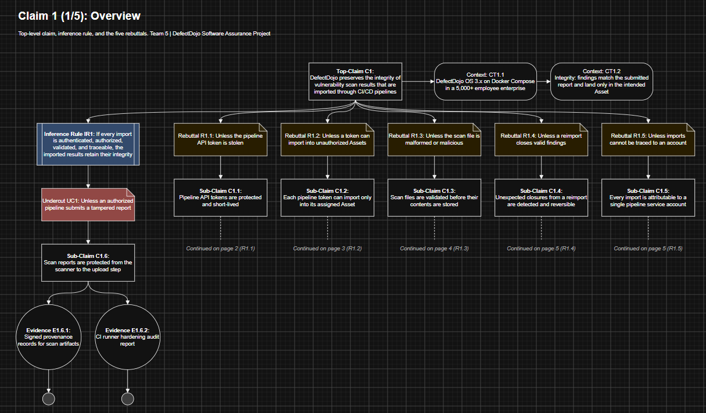
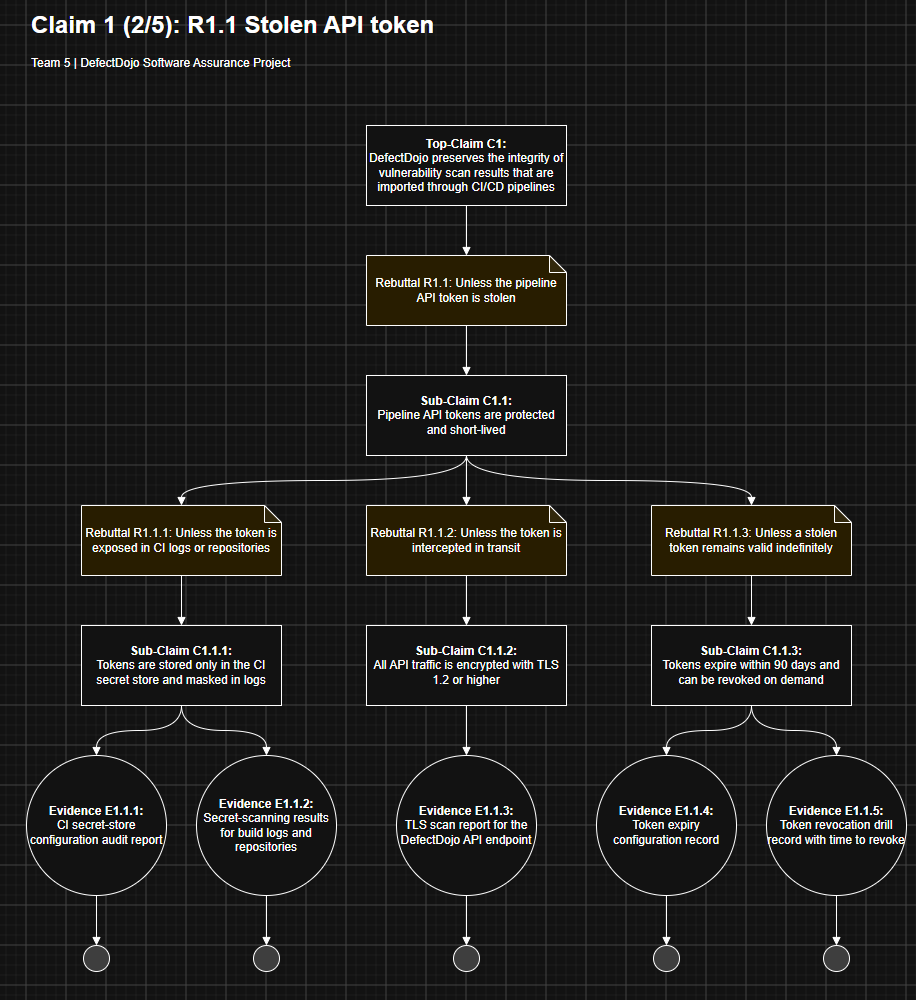
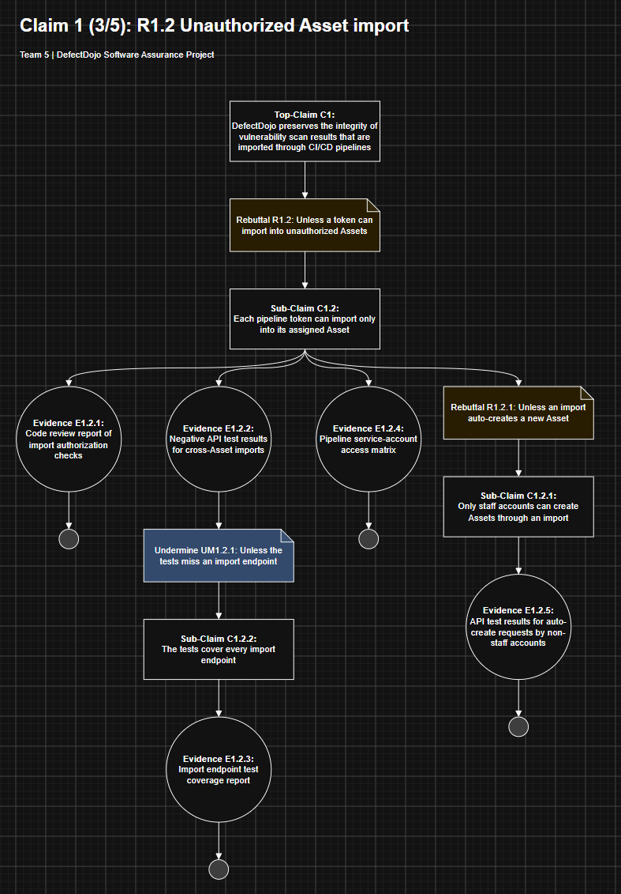
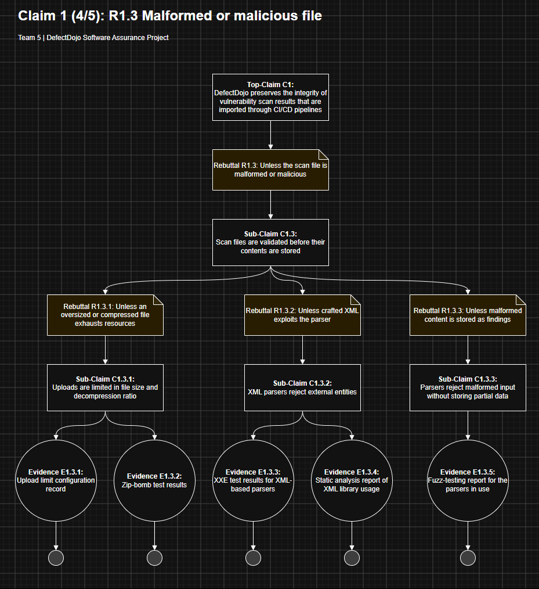
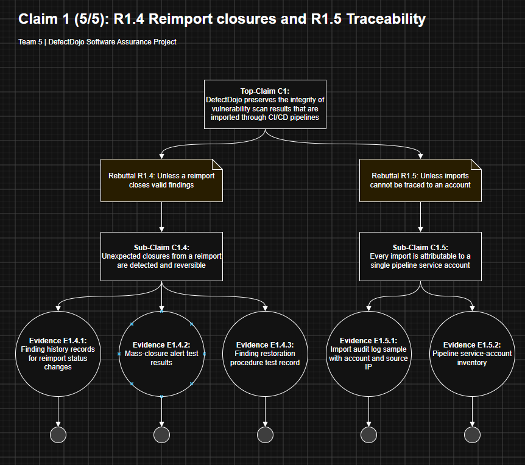
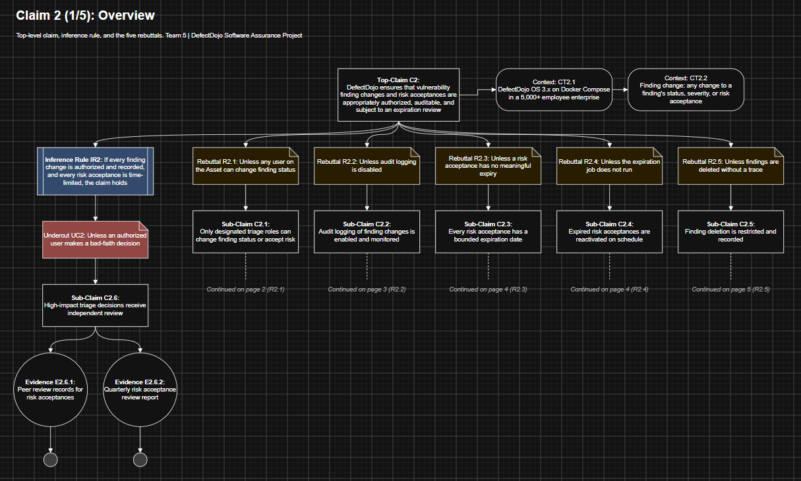
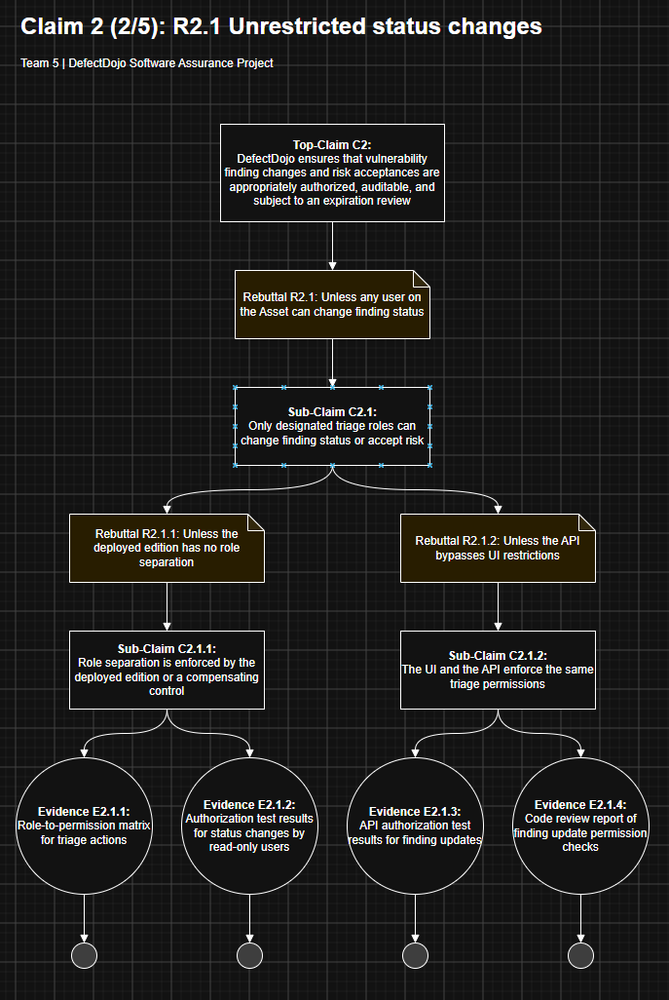
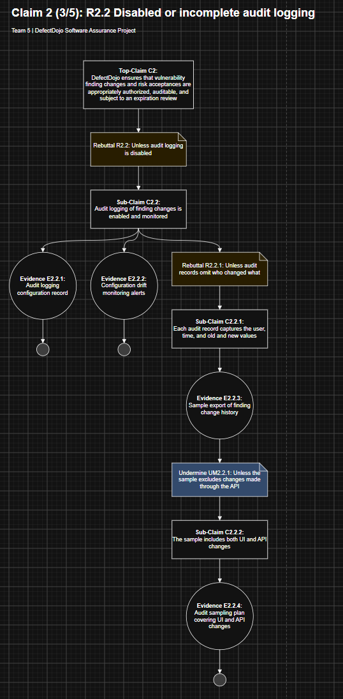
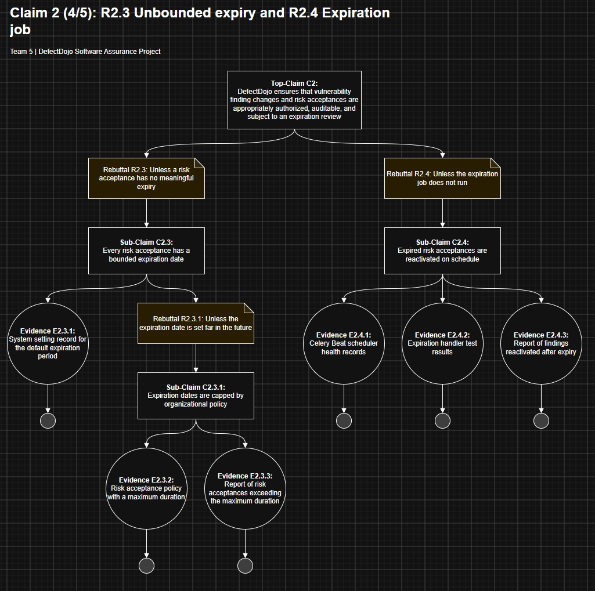
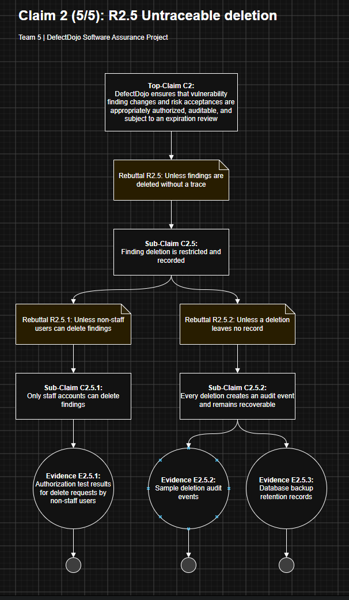

# Assurance Cases for Software Security Engineering

**Team 5**

| Member | Role |
|---|---|
| Ray Donner | Contributor |
| Grant Nichter | Team Lead |
| Alex Bahwawsi | Contributor |
| Chandler Crist | Contributor |

**Team GitHub Repository:** [github.com/creepysmilejpg/SWADjangoProject](https://github.com/creepysmilejpg/SWADjangoProject)

Task assignments, discussion, and progress tracking for this project are managed through the repository's GitHub Project Board, where issues are linked to board cards and closed only after review/comment.

---

# Part 1
## 1. Develop five top-level claims
**Claim 1. DefectDojo preserves the integrity of vulnerability scan results that are imported through CI/CD pipelines**

**Claim 2. DefectDojo ensures that vulnerability finding changes and risk acceptances are appropriately authorized, auditable, and subject to an expiration review**

**Claim 3. DefectDojo prevents users from accessing or modifying vulnerability information belonging to applications they are not authorized to**

**Claim 4. DefectDojo restricts administrative privilege changes to authorized administrators and provides auditable record of access control changes**

**Claim 5. DefectDojo protects Jira integration credentials and prevents unauthorized configuration changes and webhook interactions**


## 2. Prepare an argument for each top-level claim


# Part 2
## 1. Assess the alignment of the evidence

### Claim 1: DefectDojo preserves the integrity of vulnerability scan results that are imported through CI/CD pipelines



<details>
<summary><b>R1.1: Unless the pipeline API token is stolen</b></summary>



</details>

<details>
<summary><b>R1.2: Unless a token can import into unauthorized Assets</b></summary>



</details>

<details>
<summary><b>R1.3: Unless the scan file is malformed or malicious</b></summary>



</details>

<details>
<summary><b>R1.4 and R1.5: Unless a reimport closes valid findings / imports cannot be traced</b></summary>



</details>

### Claim 2: DefectDojo ensures that vulnerability finding changes and risk acceptances are appropriately authorized, auditable, and subject to an expiration review



<details>
<summary><b>R2.1: Unless any user on the Asset can change finding status</b></summary>



</details>

<details>
<summary><b>R2.2: Unless audit logging is disabled</b></summary>



</details>

<details>
<summary><b>R2.3 and R2.4: Unless a risk acceptance has no meaningful expiry / the expiration job does not run</b></summary>



</details>

<details>
<summary><b>R2.5: Unless findings are deleted without a trace</b></summary>



</details>

### Claim 3: DefectDojo prevents users from accessing or modifying vulnerability information belonging to applications they are not authorized to.

R3.1: Unless an endpoint skips the authorization check

R3.2: Unless lists, reports, or metrics leak other assets

R3.3: Unless staff status bypasses the access lists

R3.4: Unless an authorized user's account is hijacked

R3.5: Unless Organization-level access cascades too broadly

### Claim 4: DefectDojo restricts administrative privilege changes to authorized administrators and provides an auditable record of access control changes.

R4.1: Unless the admin account is compromised

R4.2: Unless access-list changes aren't recorded

R4.3: Unless non-staff users get permissions through Django Admin

R4.4: Unless audit records can be altered or purged

R4.5: Unless leftover API tokens keep access

### Claim 5: DefectDojo protects Jira integration credentials and prevents unauthorized configuration changes and webhook interactions.

R5.1: Unless the Jira password is stored unencrypted

R5.2: Unless the credential is exposed in the UI or API

R5.3: Unless the webhook secret is disabled or leaked

R5.4: Unless non-admins can edit the Jira configuration

R5.5: Unless Jira configuration changes aren't logged

## 2. AI enhancement 

### Overview

We used the exact prompt from the assignment details, with one key difference: we ran it alongside the **LLM Council** skill ([source](https://x.com/itsolelehmann/status/2038661433626333649?lang=en)). The skill lets Claude evaluate each claim in more depth than the prompt allows on its own. It does this by spinning up five advisors, each with a distinct perspective.

### The Five Advisors

| Advisor | Role |
|---|---|
| **The Contrarian** | Looks for what will fail. Assumes your idea has a fatal flaw and tries to find it. If everything looks solid, digs deeper. |
| **The First Principles Thinker** | Ignores your question and asks what you're actually trying to solve. Strips away assumptions. Rebuilds the problem from the ground up. |
| **The Expansionist** | Hunts for upside you're missing. What could be bigger? What adjacent opportunity is sitting right next to your question that you haven't noticed? |
| **The Outsider** | Has zero context about you, your field, or your history. Responds purely to what's in front of them. |
| **The Executor** | Only cares about one thing: what do you do Monday morning? If an idea sounds brilliant but has no clear first step, the Executor will say so. |

> *Advisor definitions are taken directly from the article linked above.*

### Adapting the Prompt

As the definitions show, each advisor is built to evaluate a **question**, not a **claim**. To account for this, we wrote a new prompt based on the original. We also made it a **reusable template**, so every claim could be dropped into the same prompt and receive equal evaluation.

**Key changes from the original prompt:**

- **Reframed as a decision.** The task becomes a question the Council can debate: *"Which 5 rebutting defeaters best challenge the claim?"*
- **Templated inputs.** `CLAIM`, `SYSTEM_CONTEXT`, and `FAILURE_SURFACE` are filled in per claim.
- **Stricter defeater rules.** The prompt requires exactly 5 defeaters. They must be rebutting only and distinct from each other. Each must start with "Unless" and be 8 words or fewer.
- **Advisor-specific focus.** Each advisor's lens is redirected toward finding or testing defeaters.
- **Fixed output format.** The output is the claim, R1–R5, the evidence that would eliminate each rebuttal, and which defeater to eliminate first.

### Original Prompt (from assignment)

```text
You are an expert software security engineer. Your job is to suggest rebutting
defeater for a given assurance claim using the concept of eliminative induction
where support/assurance increases as reasons for doubt are eliminated. Here is an
example claim for which rebutting defeaters are identified.

Claim: The bulb will glow when switched on
Rebuttal 1: Unless switch not connected to light
Rebuttal 2: Unless no power
Rebuttal 3: Unless dead light bulb

Use this statement as a potential claim for analysis. Keep the rebuttals short and
intuitive for including in a readable diagram.
"""
The login page has no exploitable SQL injection weakness
"""
```

### Prompt We Used (LLM Council template)

```text
Council this.

<claim_inputs>
CLAIM: {{The claim to analyze, in one sentence}}
SYSTEM_CONTEXT: {{What the system/component is}}
FAILURE_SURFACE: {{The areas the defeaters must cover}}
</claim_inputs>

## Decision
Which 5 rebutting defeaters best challenge the CLAIM, so that eliminating them would
give strong, justified confidence it is true? Propose candidates, pressure-test them,
and settle on exactly 5.

## Method: eliminative induction
Confidence grows as reasons for doubt are eliminated. A rebutting defeater is a
condition that, if true, shows the claim is false, phrased "Unless ...".

Example (method only, don't reuse content):
  Claim: The bulb will glow when switched on
  R1: Unless switch not connected to light
  R2: Unless no power
  R3: Unless dead light bulb

## Rules for the defeaters
- Exactly 5.
- Rebutting only: attack the claim itself, not the evidence or reasoning.
- Distinct: no two cover the same failure path.
- Together they cover the FAILURE_SURFACE and fit the SYSTEM_CONTEXT.
- "Unless <condition>", 8 words max, plain language, for a readable diagram.

## Advisor focus
- Contrarian: failure paths a typical list would miss.
- First Principles: what must be true for the claim to hold; attack each part.
- Expansionist: defeaters that also strengthen adjacent claims, staying in scope.
- Outsider: whether each defeater makes sense to a non-expert.
- Executor: whether each can be eliminated with concrete evidence.

## Chairman output
In "The Recommendation," give exactly:

  Claim: <CLAIM>
  R1: Unless ...
  R2: Unless ...
  R3: Unless ...
  R4: Unless ...
  R5: Unless ...

Add one line per rebuttal naming the evidence that would eliminate it.
In "The One Thing to Do First," name the defeater to eliminate first and why.
```

The prompt was then used with the **LLM Council** skill for each of our five claims, giving us the five rebuttles the diagrams are based on for each of the five claims above.d
