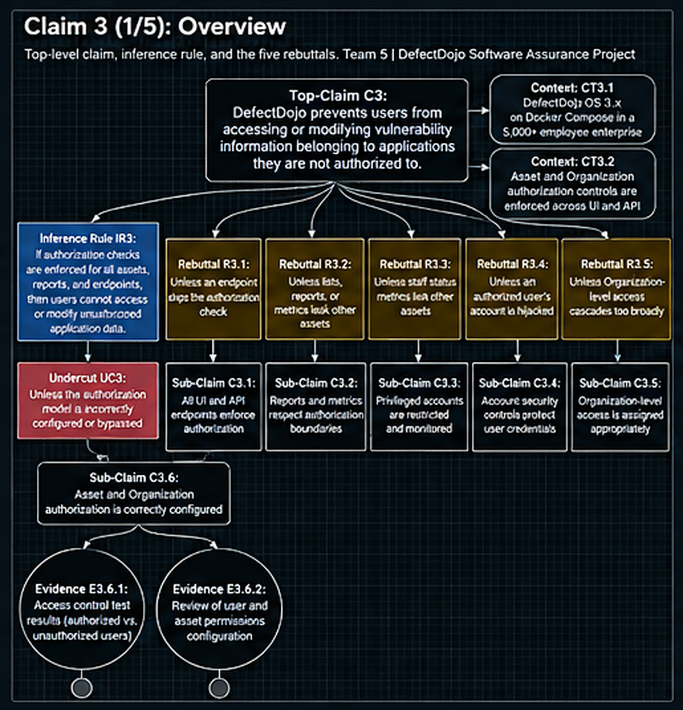
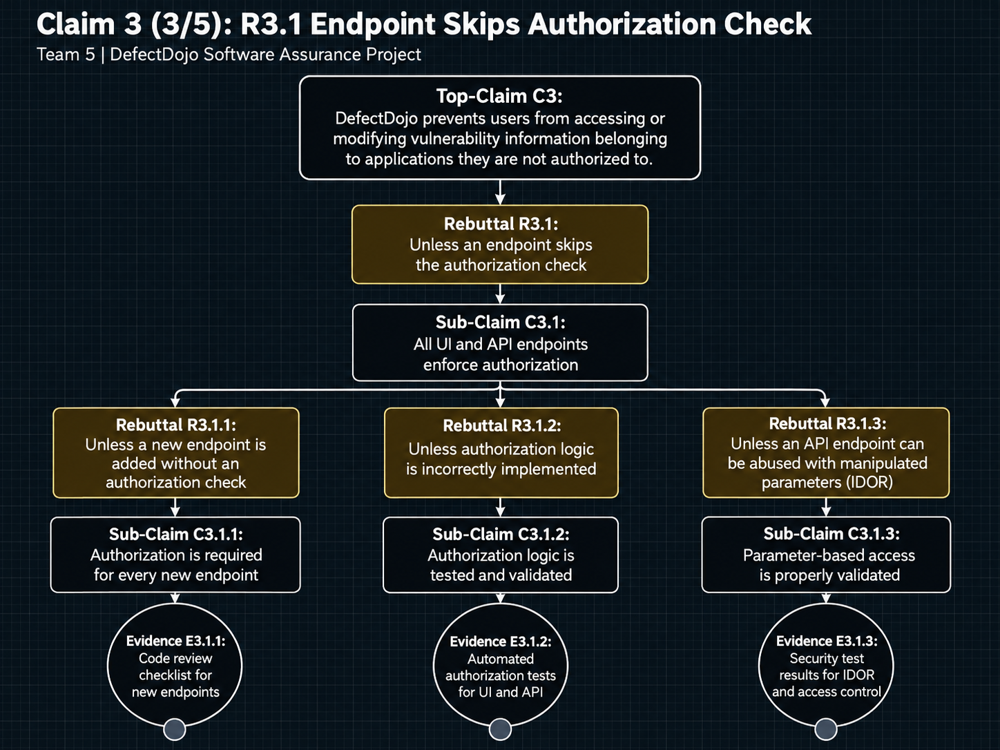
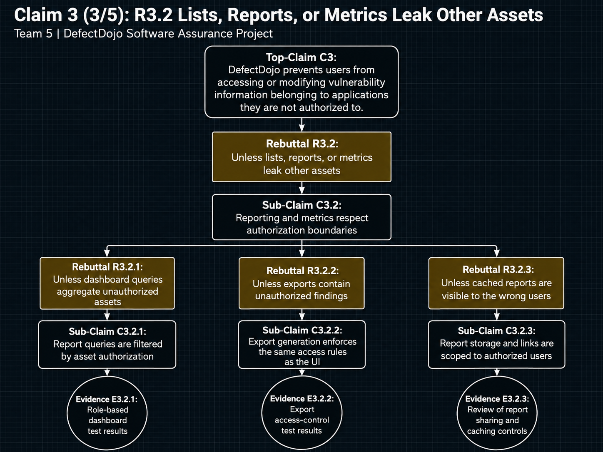
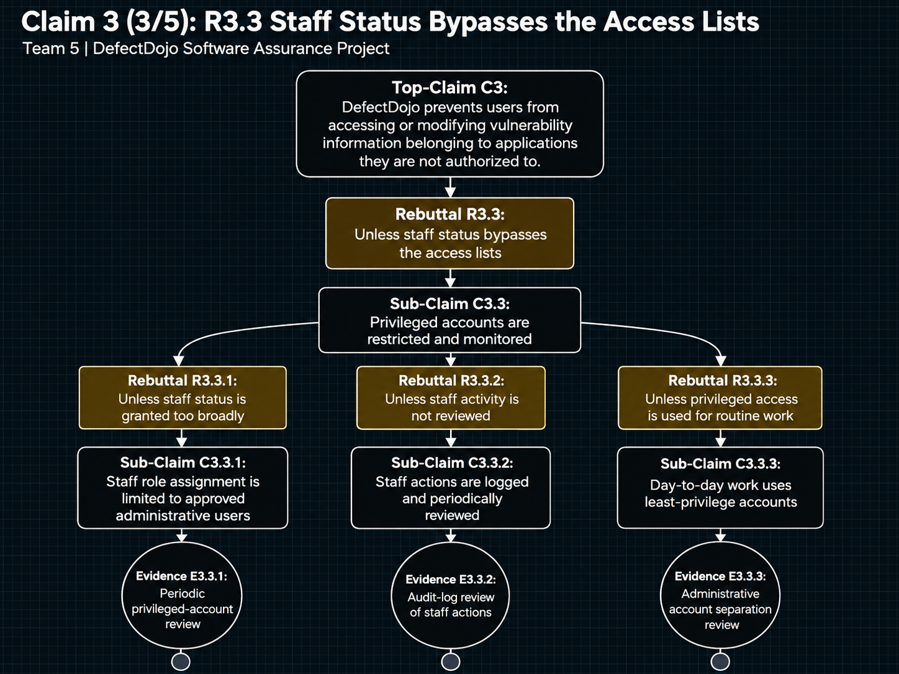
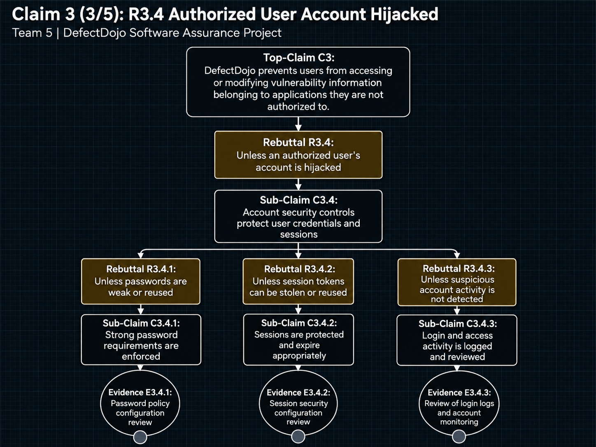
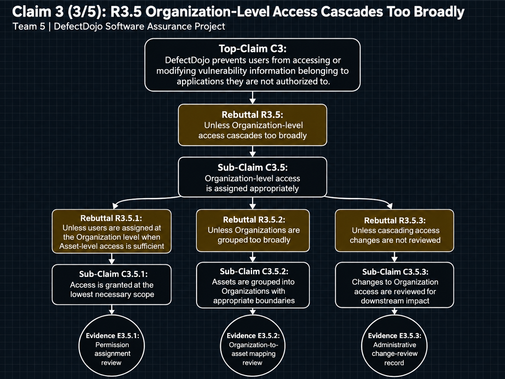

# Assurance Cases for Software Security Engineering

**Team 5**

| Member | Role |
|---|---|
| Ray Donner | Contributor |
| Grant Nichter | Team Lead |
| Alex Bahwawsi | Contributor |
| Chandler Crist | Contributor |

**Team GitHub Repository:** [github.com/creepysmilejpg/SWADjangoProject](https://github.com/creepysmilejpg/SWADjangoProject)

Task assignments, discussion, and progress tracking for this project are managed through the repository's GitHub Project Board, where issues are linked to board cards and closed only after review/comment.

---

# Part 1
## 1. Develop five top-level claims
**Claim 1. DefectDojo preserves the integrity of vulnerability scan results that are imported through CI/CD pipelines**

**Claim 2. DefectDojo ensures that vulnerability finding changes and risk acceptances are appropriately authorized, auditable, and subject to an expiration review**

**Claim 3. DefectDojo prevents users from accessing or modifying vulnerability information belonging to applications they are not authorized to**

**Claim 4. DefectDojo restricts administrative privilege changes to authorized administrators and provides auditable record of access control changes**

**Claim 5. DefectDojo protects Jira integration credentials and prevents unauthorized configuration changes and webhook interactions**


## 2. Prepare an argument for each top-level claim

### Claim 1: DefectDojo preserves the integrity of vulnerability scan results that are imported through CI/CD pipelines


<details>
<summary><b>R1.1: Unless the pipeline API token is stolen</b></summary>


</details>

<details>
<summary><b>R1.2: Unless a token can import into unauthorized Assets</b></summary>


</details>

<details>
<summary><b>R1.3: Unless the scan file is malformed or malicious</b></summary>


</details>

<details>
<summary><b>R1.4 and R1.5: Unless a reimport closes valid findings / imports cannot be traced</b></summary>


</details>

### Claim 2: DefectDojo ensures that vulnerability finding changes and risk acceptances are appropriately authorized, auditable, and subject to an expiration review


<details>
<summary><b>R2.1: Unless any user on the Asset can change finding status</b></summary>


</details>

<details>
<summary><b>R2.2: Unless audit logging is disabled</b></summary>


</details>

<details>
<summary><b>R2.3 and R2.4: Unless a risk acceptance has no meaningful expiry / the expiration job does not run</b></summary>


</details>

<details>
<summary><b>R2.5: Unless findings are deleted without a trace</b></summary>


</details>

### Claim 3: DefectDojo prevents users from accessing or modifying vulnerability information belonging to applications they are not authorized to



<details>
<summary><b>R3.1: Unless an endpoint skips the authorization check</b></summary>



</details>

<details>
<summary><b>R3.2: Unless lists, reports, or metrics leak other assets</b></summary>



</details>

<details>
<summary><b>R3.3: Unless staff status bypasses the access lists</b></summary>



</details>

<details>
<summary><b>R3.4: Unless an authorized user's account is hijacked</b></summary>



</details>

<details>
<summary><b>R3.5: Unless Organization-level access cascades too broadly</b></summary>



</details>


### Claim 4: DefectDojo restricts administrative privilege changes to authorized administrators and provides an auditable record of access control changes


R4.1: Unless the admin account is compromised

R4.2: Unless access-list changes aren't recorded

R4.3: Unless non-staff users get permissions through Django Admin

R4.4: Unless audit records can be altered or purged

R4.5: Unless leftover API tokens keep access

### Claim 5: DefectDojo protects Jira integration credentials and prevents unauthorized configuration changes and webhook interactions


R5.1: Unless the Jira password is stored unencrypted

R5.2: Unless the credential is exposed in the UI or API

R5.3: Unless the webhook secret is disabled or leaked

R5.4: Unless non-admins can edit the Jira configuration

R5.5: Unless Jira configuration changes aren't logged

## 3. AI enhancement

### Overview

We used the exact prompt from the assignment details, with one key difference: we ran it alongside the **LLM Council** skill ([source](https://x.com/itsolelehmann/status/2038661433626333649?lang=en)). The skill lets Claude evaluate each claim in more depth than the prompt allows on its own. It does this by spinning up five advisors, each with a distinct perspective.

### The Five Advisors

| Advisor | Role |
|---|---|
| **The Contrarian** | Looks for what will fail. Assumes your idea has a fatal flaw and tries to find it. If everything looks solid, digs deeper. |
| **The First Principles Thinker** | Ignores your question and asks what you're actually trying to solve. Strips away assumptions. Rebuilds the problem from the ground up. |
| **The Expansionist** | Hunts for upside you're missing. What could be bigger? What adjacent opportunity is sitting right next to your question that you haven't noticed? |
| **The Outsider** | Has zero context about you, your field, or your history. Responds purely to what's in front of them. |
| **The Executor** | Only cares about one thing: what do you do Monday morning? If an idea sounds brilliant but has no clear first step, the Executor will say so. |

> *Advisor definitions are taken directly from the article linked above.*

### Adapting the Prompt

As the definitions show, each advisor is built to evaluate a **question**, not a **claim**. To account for this, we wrote a new prompt based on the original. We also made it a **reusable template**, so every claim could be dropped into the same prompt and receive equal evaluation.

**Key changes from the original prompt:**

- **Reframed as a decision.** The task becomes a question the Council can debate: *"Which 5 rebutting defeaters best challenge the claim?"*
- **Templated inputs.** `CLAIM`, `SYSTEM_CONTEXT`, and `FAILURE_SURFACE` are filled in per claim.
- **Stricter defeater rules.** The prompt requires exactly 5 defeaters. They must be rebutting only and distinct from each other. Each must start with "Unless" and be 8 words or fewer.
- **Advisor-specific focus.** Each advisor's lens is redirected toward finding or testing defeaters.
- **Fixed output format.** The output is the claim, R1–R5, the evidence that would eliminate each rebuttal, and which defeater to eliminate first.

### Original Prompt (from assignment)

```text
You are an expert software security engineer. Your job is to suggest rebutting
defeater for a given assurance claim using the concept of eliminative induction
where support/assurance increases as reasons for doubt are eliminated. Here is an
example claim for which rebutting defeaters are identified.

Claim: The bulb will glow when switched on
Rebuttal 1: Unless switch not connected to light
Rebuttal 2: Unless no power
Rebuttal 3: Unless dead light bulb

Use this statement as a potential claim for analysis. Keep the rebuttals short and
intuitive for including in a readable diagram.
"""
The login page has no exploitable SQL injection weakness
"""
```

### Prompt We Used (LLM Council template)

```text
Council this.

<claim_inputs>
CLAIM: {{The claim to analyze, in one sentence}}
SYSTEM_CONTEXT: {{What the system/component is}}
FAILURE_SURFACE: {{The areas the defeaters must cover}}
</claim_inputs>

## Decision
Which 5 rebutting defeaters best challenge the CLAIM, so that eliminating them would
give strong, justified confidence it is true? Propose candidates, pressure-test them,
and settle on exactly 5.

## Method: eliminative induction
Confidence grows as reasons for doubt are eliminated. A rebutting defeater is a
condition that, if true, shows the claim is false, phrased "Unless ...".

Example (method only, don't reuse content):
  Claim: The bulb will glow when switched on
  R1: Unless switch not connected to light
  R2: Unless no power
  R3: Unless dead light bulb

## Rules for the defeaters
- Exactly 5.
- Rebutting only: attack the claim itself, not the evidence or reasoning.
- Distinct: no two cover the same failure path.
- Together they cover the FAILURE_SURFACE and fit the SYSTEM_CONTEXT.
- "Unless <condition>", 8 words max, plain language, for a readable diagram.

## Advisor focus
- Contrarian: failure paths a typical list would miss.
- First Principles: what must be true for the claim to hold; attack each part.
- Expansionist: defeaters that also strengthen adjacent claims, staying in scope.
- Outsider: whether each defeater makes sense to a non-expert.
- Executor: whether each can be eliminated with concrete evidence.

## Chairman output
In "The Recommendation," give exactly:

  Claim: <CLAIM>
  R1: Unless ...
  R2: Unless ...
  R3: Unless ...
  R4: Unless ...
  R5: Unless ...

Add one line per rebuttal naming the evidence that would eliminate it.
In "The One Thing to Do First," name the defeater to eliminate first and why.
```

The prompt was then used with the **LLM Council** skill for each of our five claims, giving us the five rebuttles the diagrams are based on for each of the five claims above.d

---

# Part 2
## 1. Assess the alignment of the evidence

For each claim we compared the evidence planned in the diagrams against what the DefectDojo open-source (OSS) project actually provides, using the findings from our requirements assessment (`master` branch of [django-DefectDojo](https://github.com/DefectDojo/django-DefectDojo), release line 3.0.x, reviewed September 2026) and the assumed operational environment from our proposal (a 5,000-employee enterprise running the OSS edition with CI/CD-driven imports and a Jira integration). Each evidence item is placed in one of three categories:

| Category | Meaning |
|---|---|
| **Available** | The artifact exists in the OSS project or can be exported from a standard deployment with no extra engineering (code, tests, settings, documented behavior, audit tables). |
| **Can be made available** | The OSS project supports it, but the adopting organization must generate the artifact (run a scan, write a test, export a sample, record a configuration decision). |
| **Requires additional effort** | The OSS project does not provide the control or the artifact; producing the evidence needs a code change, the Pro edition, or a compensating control outside DefectDojo. These are the gaps. |

### Claim 1: Integrity of CI/CD-imported scan results

| Evidence | Planned artifact | Alignment | Notes |
|---|---|---|---|
| E1.1.1 | CI secret-store configuration audit report | Can be made available | Lives in the organization's CI platform (GitHub Actions, GitLab, Jenkins), not in DefectDojo. Routine export for most platforms. |
| E1.1.2 | Secret-scanning results for build logs and repositories | Can be made available | Tooling such as gitleaks or GitHub secret scanning; DefectDojo's own API-key format is not registered with any secret-scanning provider, so a custom pattern would be needed. |
| E1.1.3 | TLS scan report for the DefectDojo API endpoint | Can be made available | TLS is terminated at the bundled nginx container or an external proxy. An `sslscan`/`testssl.sh` run against the deployed endpoint produces this directly. |
| E1.1.4 | Token expiry configuration record | **Requires additional effort** | OSS API tokens are standard DRF tokens with **no expiration**. The only controls are regeneration and the `DD_API_TOKENS_ENABLED` kill switch. Enforcing a 90-day lifetime needs a scheduled rotation script or a code change. This is the largest gap under Claim 1. |
| E1.1.5 | Token revocation drill record with time to revoke | Can be made available | Regenerating a user's token invalidates the old one immediately. The drill is an organizational exercise that can be run on a standard deployment. |
| E1.2.1 | Code review report of import authorization checks | Available | `dojo/authorization/authorization.py`, `api_permissions.py`, and the import serializers are already in the repo and were partially reviewed in our requirements assessment. |
| E1.2.2 | Negative API test results for cross-Asset imports | Available (partially) | The upstream `unittests/` suite contains import authorization tests, but they exercise the OSS `authorized_users` model only; targeted negative tests for tokens belonging to service accounts still need to be written. |
| E1.2.3 | Import endpoint test coverage report | Can be made available | `coverage.py` is already part of the upstream test tooling; the report just has to be generated and filtered to the import/reimport views. |
| E1.2.4 | Pipeline service-account access matrix | Can be made available | An organizational artifact mapping each pipeline token to its Asset. DefectDojo offers no built-in view of this, so it is maintained manually. |
| E1.2.5 | API test results for auto-create requests by non-staff accounts | Can be made available | `auto_create_context` is available through the API in OSS. Our requirement SR-1.3 called for the same authorization check on auto-created objects; a negative test needs to be written to confirm it. |
| E1.3.1 | Upload limit configuration record | Available | `DD_SCAN_FILE_MAX_SIZE` and the archive-handling limits added after CVE-2026-3816 are documented settings that can be exported from the running configuration. |
| E1.3.2 | Zip-bomb test results | Can be made available | Upstream hardening exists; a test with a crafted archive against a staging instance confirms it. |
| E1.3.3 | XXE test results for XML-based parsers | Can be made available | DefectDojo has dozens of XML parsers and library use is not uniform. A targeted XXE test per parser in use (not all parsers) is needed. |
| E1.3.4 | Static analysis report of XML library usage | Available | A `grep`/Semgrep pass over `dojo/tools/` for `lxml`, `xml.etree`, and `defusedxml` can be produced directly from the repo. |
| E1.3.5 | Fuzz-testing report for the parsers in use | **Requires additional effort** | No upstream fuzzing harness exists. Building one for the handful of parsers the organization uses is new work. |
| E1.4.1 | Finding history records for reimport status changes | Available | pghistory tracks finding status changes, including those made by reimport's `close_old_findings` behavior. |
| E1.4.2 | Mass-closure alert test results | **Requires additional effort** | DefectDojo has no alert for an unusual number of findings closed by a single reimport. This would be a custom notification rule or an external SIEM rule on the audit table. |
| E1.4.3 | Finding restoration procedure test record | Can be made available | Findings closed by reimport can be reopened individually; a documented and tested bulk-restore procedure (from history or DB backup) is an organizational runbook. |
| E1.5.1 | Import audit log sample with account and source IP | Available | pghistory captures the acting user and source IP on tracked models, which is exactly this artifact. |
| E1.5.2 | Pipeline service-account inventory | Can be made available | Organizational artifact; overlaps with E1.2.4. |

### Claim 2: Authorization, auditability, and expiration of finding changes and risk acceptances

| Evidence | Planned artifact | Alignment | Notes |
|---|---|---|---|
| E2.1.1 | Role-to-permission matrix for triage actions | **Requires additional effort** | The hierarchical RBAC (Reader/Writer/Maintainer/Owner) has moved to the Pro edition. In OSS, authorization is binary: a user on an Asset's `authorized_users` list can do everything on that Asset. A meaningful matrix therefore requires either the Pro plugin or a compensating control (for example, separate read-only reporting accounts that are never added to `authorized_users`). |
| E2.1.2 | Authorization test results for status changes by read-only users | **Requires additional effort** | There is no read-only role in OSS to test against. This evidence depends on whichever compensating control is chosen for E2.1.1. |
| E2.1.3 | API authorization test results for finding updates | Available (partially) | Upstream tests cover the `authorized_users` check on finding update endpoints; they confirm UI/API parity, not role separation. |
| E2.1.4 | Code review report of finding update permission checks | Available | `authorization_decorators.py` and `api_permissions.py` apply the same function on both surfaces and can be reviewed directly. |
| E2.2.1 | Audit logging configuration record | Available | pghistory tracking is enabled in code for the core models; the setting state can be exported from the deployment. |
| E2.2.2 | Configuration drift monitoring alerts | Can be made available | Requires external configuration management (for example, a checksum of `settings.dist.py`/environment file in the deployment pipeline). Not provided by DefectDojo. |
| E2.2.3 | Sample export of finding change history | Available | Finding history is viewable in the UI and queryable from the pghistory event tables. |
| E2.2.4 | Audit sampling plan covering UI and API changes | Can be made available | Because both surfaces write through the same ORM models, pghistory records both. The sampling plan is an organizational document. |
| E2.3.1 | System setting record for the default expiration period | Available | The risk-acceptance default expiration days and warning days are System Settings fields. |
| E2.3.2 | Risk acceptance policy with a maximum duration | Can be made available | Organizational policy document. DefectDojo does not enforce a maximum, so the policy must be paired with E2.3.3. |
| E2.3.3 | Report of risk acceptances exceeding the maximum duration | Can be made available | Simple query against the `Risk_Acceptance` table or via the API; no built-in report exists. |
| E2.4.1 | Celery Beat scheduler health records | Can be made available | The Celery Beat container is part of the standard deployment; health records come from container monitoring. |
| E2.4.2 | Expiration handler test results | Available | The expiration workflow (warn, handle, reactivate) has upstream unit tests. |
| E2.4.3 | Report of findings reactivated after expiry | Available | Reactivation changes finding status and is captured by pghistory, so this is a filtered history export. |
| E2.5.1 | Authorization test results for delete requests by non-staff users | Available (partially) | Upstream tests exist for the `authorized_users` check on delete; note that in OSS, an authorized non-staff user **can** delete findings on their own Asset, so the sub-claim "only staff accounts can delete findings" is only true if the organization keeps developers off `authorized_users` or restores roles via Pro. |
| E2.5.2 | Sample deletion audit events | Available | pghistory records deletes with the acting user. |
| E2.5.3 | Database backup retention records | Can be made available | Organizational backup policy; standard for a PostgreSQL deployment. |

### Claim 3: Cross-application access control

| Rebuttal | Evidence needed to close the branch | Alignment | Notes |
|---|---|---|---|
| R3.1 | Code review report of authorization decorator coverage across UI views and API viewsets | Available | The decorators and permission classes are centralized and can be inventoried against the view list. The recurring IDOR advisories (GHSA-9jr7-2hgp-vhp8, GHSA-96vq-gqr9-vf2c, GHSA-jwr5-h452-j325) argue for repeating this review on every upgrade. |
| R3.2 | Test results for list, report, and metrics endpoints using a user authorized on one Asset | Can be made available | `query_filters.py` filters list endpoints; metrics and report views need their own negative tests, which are not comprehensively covered upstream. |
| R3.3 | Staff-account inventory and justification record | Can be made available | Staff and superuser status bypass all access lists by design in OSS. The evidence is organizational: a short, reviewed list of who holds staff status and why. |
| R3.4 | MFA/SSO enforcement record at the reverse proxy or identity provider | **Requires additional effort** | OSS now provides local username/password login only; MFA and SSO (SAML/OAuth2/LDAP) have moved to Pro. The organization must front DefectDojo with an authenticating proxy or identity-aware gateway. |
| R3.5 | Organization-level `authorized_users` membership review record | Can be made available | Cascade is by design. The evidence is a periodic review showing Organization-level membership is limited to platform staff. |

### Claim 4: Administrative privilege changes

| Rebuttal | Evidence needed to close the branch | Alignment | Notes |
|---|---|---|---|
| R4.1 | MFA enforcement record for superuser accounts and login rate-limit configuration | **Requires additional effort** (MFA) / Available (rate limiting) | Rate limiting is a documented OSS setting. MFA for superusers depends on the same external control as R3.4. |
| R4.2 | Audit log sample of `authorized_users` list changes on Assets and Organizations | **Requires additional effort** | This is the most significant gap we found. pghistory tracks `Product` and `Product_Type` columns, but a ManyToMany membership change does not alter a column on the parent row, so adding a user to an Asset leaves **no audit event**. Closing it requires registering the through-table with pghistory (a small code change we intend to propose upstream) or moving to the Pro edition. |
| R4.3 | Django Admin permission audit showing no `auth.add_user` grants to non-staff users | Can be made available | A query against `auth_user_user_permissions` and group permissions; must be repeated periodically. |
| R4.4 | Database role configuration showing the application role cannot modify pghistory tables | Can be made available | pghistory tables are ordinary PostgreSQL tables. Protecting them requires a separate database role with `INSERT`-only access, which is configurable but not the default. |
| R4.5 | `DD_API_TOKENS_ENABLED` configuration record and API token inventory with last-used dates | Available (kill switch) / **Requires additional effort** (inventory) | The kill switch exactly matches the requirement. DRF tokens have no last-used timestamp, so an inventory with usage dates needs a middleware addition or log-based reconstruction. |

### Claim 5: Jira integration credentials and configuration

| Rebuttal | Evidence needed to close the branch | Alignment | Notes |
|---|---|---|---|
| R5.1 | Database column inspection showing the Jira password is encrypted at rest | **Requires additional effort** | The `JIRA_Instance.password` field is stored in plaintext in the OSS database. Evidence can only come from a compensating control: database-level encryption, a secrets manager that injects the value at runtime, or a field-level encryption patch. |
| R5.2 | API serializer test results confirming the password is write-only | Can be made available | The REST serializer for Jira instances should mark the password write-only; a targeted test against `/api/v2/jira_instances/` confirms it and should be added to the regression suite. |
| R5.3 | Webhook secret configuration record and negative test with an incorrect secret | Available | The webhook secret and the "disable webhook secret" toggle are System Settings fields; a negative test is straightforward. |
| R5.4 | Authorization test results for Jira configuration changes by non-superusers | Available | Configuration permissions reduce to `is_superuser`/`is_staff` in OSS, and this can be tested directly. |
| R5.5 | Audit log sample for `JIRA_Instance` and System Settings changes | Can be made available, pending verification | We have not yet confirmed whether `JIRA_Instance` and `System_Settings` are registered with pghistory. If they are not, this becomes a gap of the same kind as R4.2. |

### Summary of gaps

Across the five claims, roughly a quarter of the planned evidence is available directly from the OSS project or a standard deployment, about half can be produced by the adopting organization with ordinary effort, and the remainder requires additional engineering or a compensating control. The gaps cluster into four themes:

1. **Identity hardening is outside the OSS edition.** MFA, SSO, and API token expiry (R1.1, R3.4, R4.1, R4.5) all have to be supplied by an external identity provider, reverse proxy, or rotation script. Without this, every claim that depends on "the account was not hijacked" rests on a password alone.
2. **Role separation no longer exists in OSS.** The Reader/Writer/Maintainer/Owner roles moved to Pro, so the sub-claims under R2.1 and R2.5 about "only designated roles" or "only staff" are true only with a compensating account-management practice. The documentation still describes these roles, which makes this gap easy to miss.
3. **Access-list changes are not audited.** `authorized_users` membership changes on Assets and Organizations leave no pghistory event (R4.2), and we have not yet verified audit coverage for Jira and System Settings (R5.5). This is the one gap we believe is best fixed with a small upstream code change rather than a compensating control.
4. **Secrets at rest.** The Jira password is stored in plaintext (R5.1), which can only be addressed outside the application in the current OSS codebase.

Where the OSS project is strongest is auditability of findings and risk acceptances (pghistory with user and source IP), the risk acceptance expiry workflow, the centralized authorization function shared by the UI and API, and the API token kill switch. Those areas produced the largest share of "Available" evidence and are where an adopting organization can build confidence quickly.

## 2. Team GitHub repository

**Repository:** [github.com/creepysmilejpg/SWADjangoProject](https://github.com/creepysmilejpg/SWADjangoProject)

Work for this assignment was tracked on the repository's GitHub Project Board. Each top-level claim was opened as an issue and assigned to one team member, with the LLM Council run, the draw.io diagram, and the evidence alignment for that claim handled as sub-tasks on the same card. Diagram exports live under `docs/diagrams/`, and the draw.io source files were committed alongside them so other members could review and comment on branches before cards were closed. Cards were moved to Done only after another team member reviewed the diagram for notation and wording issues (claims phrased as predicates, evidence phrased as noun phrases, rebuttals beginning with "Unless").

## 3. Reflection

### Individual reflections

**Alex Bahwawsi.** The most useful thing I took from this assignment was learning to separate a claim from the mechanism that supports it. My first drafts kept sliding into "DefectDojo uses pghistory" or "DefectDojo uses token authentication," and the prompt from the assignment made it obvious why those are not claims: they say nothing about the outcome a stakeholder actually cares about. Rewriting them as outcomes (imports can be traced to a single account, expired risk acceptances are reactivated on schedule) forced me to think about what would have to be true for a stakeholder to trust the system, and that in turn made the rebuttals almost write themselves. The second thing I learned is that evidence is harder to write than claims. Keeping every leaf node as a noun phrase (a configuration record, a test result, a sample export) made it very clear when I was hand-waving. If I could not name a tangible artifact, I usually did not have an argument yet. Finally, the alignment assessment in Part 2 was a reality check. Several branches that looked solid in the diagram turned out to depend on features that have moved to the Pro edition, which reinforced the lesson from our requirements assessment that documentation and shipped code are not the same thing.

**Grant Nichter.** To be honest, the most useful thing I took away from this assignment wasn’t really the information we gathered about DefectDojo. Don’t get me wrong, creating and hardening these claims gave me a much better understanding of how the product is laid out. That information will be important for the project going forward, and it helped my own understanding of DefectDojo a lot. However, what I found the most interesting was getting to use AI to enhance the claims. As stated in the AI enhancement section, I used a skill that made evaluating each of the claims extremely in-depth. Going through the process of creating that prompt was also a learning experience on its own. Figuring out what to ask for and how to structure it took some trial and error, and it showed me that the quality of what you get back from AI depends heavily on how much thought you put into the instructions you give it. Seeing how much it helped us build the most solid claims we could was really interesting to me. Most importantly, this is something I will absolutely be using in the future for other projects. Overall, this assignment gave me a better understanding of DefectDojo, but it also gave me a new way of approaching my work that I can carry into other classes and eventually my career.

**Ray Donner.** *[To be added by Ray.]*

**Chandler Crist.** *[To be added by Chandler.]*

### Team reflection

As a team, the central lesson was that an assurance case is a planning tool, not a description of the software as it exists today. Building the arguments before checking the open-source project told us what evidence an organization would need to see, and the alignment assessment then told us how far the OSS edition is from providing it. The gap between those two views (particularly role separation, access-list auditing, and MFA) is more informative than either view alone, and it gave us a concrete, prioritized list of what an adopting organization would have to add.

We also found eliminative induction to be a practical way to structure the work. Starting from "the claim is true unless..." kept each branch focused on a single failure path, made the diagrams readable, and made it easy to divide the work: each member owned a claim and its five rebuttals, and review consisted of asking whether each branch really terminated in something tangible. The AI-assisted step was most valuable for breadth of rebuttals and for policing the wording of evidence, and least reliable for knowing which controls actually exist in the OSS edition. That combination, with AI for brainstorming and the team for verification against the code, is the workflow we expect to carry into the code review and testing milestones.
