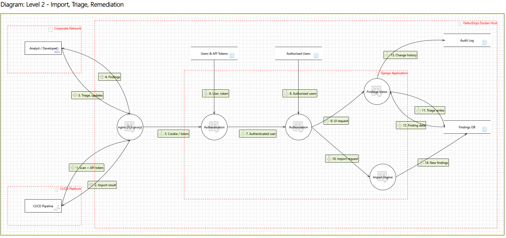
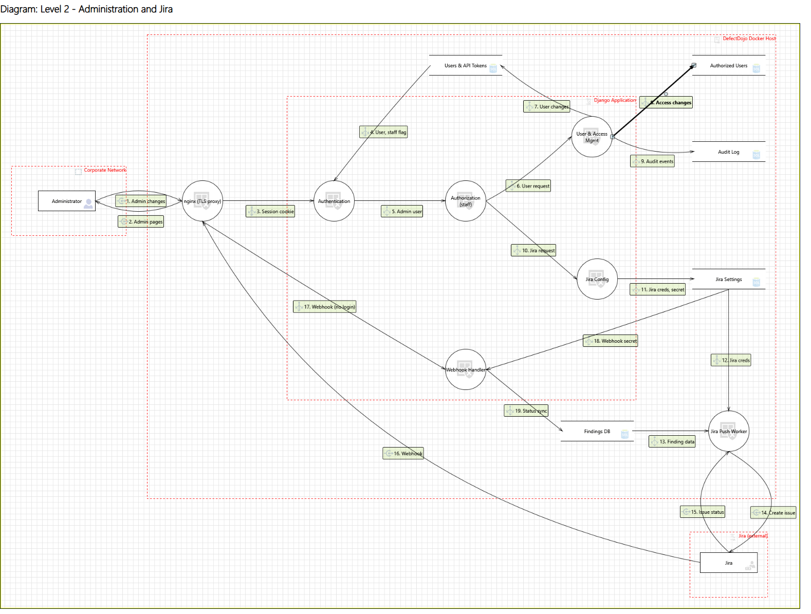

# Threat Modeling for Software Security Engineering

**Team 5**

| Member | Role |
|---|---|
| Ray Donner | Contributor |
| Grant Nichter | Team Lead |
| Alex Bahwawsi | Contributor |
| Chandler Crist | Contributor |

**Team GitHub Repository:** [github.com/creepysmilejpg/SWADjangoProject](https://github.com/creepysmilejpg/SWADjangoProject)

Task assignments, discussion, and progress tracking for this project are managed through the repository's GitHub Project Board, where issues are linked to board cards and closed only after review/comment.

---

# Part 1
## 1. Data flow diagrams for critical data flows

The DFDs below support the five scenarios prioritized in the Security Requirements and Assurance Case assignments. They were drawn in the Microsoft Threat Modeling Tool (TMT) using the Azure Threat Model Template. One Level 1 diagram shows the DefectDojo container architecture across all five scenarios. Two Level 2 diagrams decompose the Django application into the components that enforce authentication, authorization, auditing, and the Jira integration.

| Scenario | Interaction (from Requirements assignment) | Assurance claim | Covered by |
|---|---|---|---|
| S1 | CI/CD pipeline imports scan results through the API | Claim 1 | Level 1, Level 2 (Import, Triage, Remediation) |
| S2 | Security analyst triages findings and records risk acceptance | Claim 2 | Level 1, Level 2 (Import, Triage, Remediation) |
| S3 | Developer views and remediates findings for their own asset | Claim 3 | Level 1, Level 2 (Import, Triage, Remediation) |
| S4 | Administrator manages users and access | Claim 4 | Level 1, Level 2 (Administration and Jira) |
| S5 | DefectDojo pushes findings to Jira | Claim 5 | Level 1, Level 2 (Administration and Jira) |

**Trust boundaries used in the DFDs**

| Trust boundary | What it separates |
|---|---|
| Corporate Network | Human users (analysts, developers, administrators) and their browsers |
| CI/CD Platform | The pipeline and security scanners that call the DefectDojo API |
| DefectDojo Docker Host | The containers of the default Docker Compose deployment; only nginx publishes ports |
| Django Application | The uWSGI process that performs authentication, authorization, and business logic (Level 2 only) |
| Jira (external) | The Atlassian Jira service that receives pushed findings and sends webhooks |

### Level 1: DefectDojo System

The Level 1 DFD shows the five external interactors reaching DefectDojo through nginx (TLS termination), the Django application reading and writing PostgreSQL, asynchronous work passing through the Valkey task queue to the Celery worker, and the Celery worker exchanging data with Jira. The Jira webhook is the only flow that enters DefectDojo from an external service without a user session.

### Level 2: Scan Import, Triage, and Remediation (S1-S3)

Every request passes through Authentication (session cookie or API token, checked against Users & API Tokens) and then Authorization (checked against the Authorized Users lists) before reaching Findings Views or the Import Engine. Triage changes made in Findings Views are written to the Findings DB and recorded in the Audit Log.

### Level 2: Administration and Jira Integration (S4-S5)

Administrator requests pass through Authentication and a staff/superuser Authorization check before reaching User & Access Management or Jira Config. Two design points from earlier assignments are visible here. Access-list changes are written to Authorized Users without a corresponding audit event. The Jira webhook reaches the Webhook Handler without passing through Authentication, so it is protected only by the shared secret in the URL.

---

## 2. Threat analysis using the Microsoft Threat Modeling Tool

### Method

Threats were generated automatically by TMT's Analysis View for the Level 1 and Level 2 diagrams. Each threat was reviewed and assigned one of three states:

- **Mitigated:** DefectDojo or the deployment already addresses the threat; the justification names the control.
- **Needs Investigation:** the threat is relevant and not fully addressed; a mitigation strategy is documented.
- **Not Applicable:** the threat does not apply to this deployment; the justification explains why.

> **TODO:** Need to go through and figure out which threats have been mitigated by DefectDojo, which ones need investigation, and which ones are not applicable.

| Diagram | Threats generated | Mitigated | Needs Investigation | Not Applicable |
|---|---|---|---|---|
| Level 1 - DefectDojo System | 19 | 0 | 0 | 0 |
| Level 2 - Import, Triage, Remediation | 27 | 0 | 0 | 0 |
| Level 2 - Administration and Jira | 0 | 0 | 0 | 0 |
| **Total** | **91** | **0** | **0** | **0** |

| STRIDE category | Count |
|---|---|
| Spoofing | 0 |
| Tampering | 20 |
| Repudiation | 10 |
| Information Disclosure | 20 |
| Denial of Service | 0 |
| Elevation of Privilege | 41 |

### Threats on flows that cross trust boundaries

These flows cross a trust boundary in the DFDs, so their threats are reviewed first and in the most detail.

| Diagram | Flow | Boundary crossed | Why it matters |
|---|---|---|---|
| Level 1 | 1-2 Scan + API token / Import result | CI/CD Platform → Docker Host | A stolen pipeline token can import or alter findings (Claim 1) |
| Level 1 | 3-6 User and admin requests | Corporate Network → Docker Host | Session theft or credential guessing against local accounts; no MFA in OSS |
| Level 1 | 15-16 Create issue / Issue status | Docker Host ↔ Jira | Jira credentials leave DefectDojo; responses are trusted |
| Level 1 | 17 Webhook | Jira → Docker Host | Unauthenticated inbound call protected only by a URL secret |
| Level 2 (Import) | 5 Cookie / token | nginx → Django Application | Entry point for all authentication decisions |
| Level 2 (Import) | 11-14 Triage writes, Finding data, Change history, New findings | Django Application ↔ data stores | Integrity of findings and completeness of the audit trail (Claim 2) |
| Level 2 (Admin) | 7-9 User changes, Access changes, Audit events | Django Application → data stores | Access-list changes are not audited (Claim 4) |
| Level 2 (Admin) | 11-12 Jira creds, secret | Django Application → Jira Settings → Push Worker | Jira password stored unencrypted (Claim 5) |
| Level 2 (Admin) | 16-17 Webhook / Webhook (no login) | Jira → nginx → Webhook Handler | Bypasses Authentication entirely (Claim 5) |

> **TODO:** For each threat TMT generated on the flows above, add a row below. Use the threat ID and title exactly as shown in TMT's Threat List or the HTML report.

| TMT ID | Threat title | STRIDE | Flow / element | State | Mitigation strategy |
|---|---|---|---|---|---|
| TODO | TODO | TODO | TODO | TODO | TODO |
| TODO | TODO | TODO | TODO | TODO | TODO |

### Other relevant threats

> **TODO:** Add the remaining threats your team marked as Mitigated or Needs Investigation. These are threats on flows inside a single boundary. Group them by diagram.

| TMT ID | Threat title | STRIDE | Flow / element | State | Mitigation strategy |
|---|---|---|---|---|---|
| TODO | TODO | TODO | TODO | TODO | TODO |

### Threats marked Not Applicable

> **TODO:** List each Not Applicable threat with a one-line reason (for example, an Azure-specific threat that does not apply to a Docker Compose deployment).

| TMT ID | Threat title | Reason not applicable |
|---|---|---|
| TODO | TODO | TODO |

---

## 3. Mitigation strategies

> **TODO:** Summarize the mitigation strategies from Section 2 into a short list. Prefer controls that DefectDojo implements; note where a control is only available as configuration, in DefectDojo Pro, or in the hosting environment.

| # | Mitigation strategy | Threats addressed (TMT IDs) | Provided by | Related claim |
|---|---|---|---|---|
| M1 | TODO | TODO | DefectDojo / Configuration / Pro / Environment | TODO |
| M2 | TODO | TODO | TODO | TODO |
| M3 | TODO | TODO | TODO | TODO |

> **TODO:** Add a short paragraph comparing these mitigations with the gaps found in earlier assignments (no role separation, unaudited access-list changes, plaintext Jira password, no MFA in OSS).

---

## 4. TMT HTML report

**Full TMT report (rendered):** [DefectDojo Threat Model Report](https://htmlpreview.github.io/?https://github.com/creepysmilejpg/SWADjangoProject/blob/main/docs/DefectDojo_threat_report.html)

---

## 5. Team GitHub repository

> **TODO:** Describe how this assignment was tracked on the Project Board (who owned which diagram or set of threats, and how cards were reviewed before being closed). Add the board link if the assignment asks for it.

---

# Part 2: Observations and Reflection

## 1. Review of the OSS project for expected mitigations

### Scope and method

Part 1 and the [Issue #12 threat review](./threat-modeling/Issue12_TMT_Threat_Review.md) left us with a list of mitigations we *expected* DefectDojo to have: nine mitigation groups for the 91 TMT findings (codes **Q, I, T, L, D, S, N, P, A**), plus the controls for the boundary-crossing flows that TMT did not generate findings for (CI/CD token, user sessions, Jira credentials, Jira webhook, access-list changes). The Issue #12 review deliberately made no claim that any of them exist. This section checks them against the code.

We read the `master` branch of [django-DefectDojo](https://github.com/DefectDojo/django-DefectDojo) at commit `149270c` (`dojo/__init__.py` version 3.5.202, reviewed November 20, 2026), focusing on the default Docker Compose deployment that our DFDs model: `docker-compose.yml`, `docker-compose.override.https.yml`, `nginx/`, `Dockerfile.*`, `dojo/settings/settings.dist.py`, `dojo/auditlog/`, `dojo/authorization/`, `dojo/user/`, `dojo/jira/`, and the raw-SQL call sites under `dojo/`. This was a static review of code and default configuration. We did not deploy the stack or run tests, so "present" means the control is in the code and enabled by default, not that we confirmed it works.

| Status | Meaning |
|---|---|
| **Present** | Implemented in the OSS code and active in the default deployment. |
| **Partial** | Implemented but off by default, incomplete, or dependent on the operator changing a setting. |
| **Gap** | Not implemented in OSS; needs a code change, the Pro edition, or a control outside DefectDojo. |

### Mitigations for the TMT-generated threats (data stores and task queue)

| Code | Expected mitigation | What the project implements | Status |
|---|---|---|---|
| **N** | Only nginx reachable from outside the Docker host; PostgreSQL and Valkey not published | In `docker-compose.yml`, `nginx` is the only service with a `ports:` entry (8080 and 8443). `postgres` and `valkey` are reachable only on the Compose network. The Django and nginx images drop to a non-root user (`USER ${uid}`). | **Present** |
| **S** | Parameterized SQL; no query text built from untrusted input | Data access is through the Django ORM. The raw-SQL call sites we read (`dojo/tags/utils.py`, `dojo/finding/helper.py`, `dojo/finding/deduplication.py`, `dojo/endpoint/utils.py`, `dojo/importers/import_lock.py`) bind values with `%s` parameters and interpolate only table names taken from model metadata through `quote_name()`. The f-string SQL in `dojo/auditlog/backfill.py` and the `pghistory_*` management commands uses internal table names, not request data. | **Present** |
| **Q** | Valkey limited to the private network, with authentication and no code execution through queued messages | Network isolation is present (see N). Celery accepts JSON only (`CELERY_ACCEPT_CONTENT = ["json"]`, JSON task and result serializers), which removes the pickle deserialization route. There is no authentication: the default broker and cache URLs are `redis://valkey:6379/0` and `/1` with no password, the `valkey` service sets no `requirepass` or ACL, and there is no TLS between containers. | **Partial** |
| **P** | Strong, unique service credentials | The mechanism exists: every secret can be overridden by environment variable, and `docker/secret-file-loader.sh` loads `DD_*_FILE` variables from Docker secrets. The defaults are weak: the database user and password are both `defectdojo`, and `docker-compose.yml` ships fixed fallback values for `DD_SECRET_KEY` and `DD_CREDENTIAL_AES_256_KEY`. The file's header says it is not meant for production without customization, but nothing refuses to start with the defaults. | **Partial** |
| **A** | Least-privilege database roles; object-level authorization in the application | Application-level authorization is present and centralized in `dojo/authorization/authorization.py` (superuser, staff, or `authorized_users` membership up the object hierarchy). At the database layer there is no separation: `uwsgi`, `celeryworker`, `celerybeat`, and `initializer` all connect with the same `DD_DATABASE_URL`, and that account is the `POSTGRES_USER` the official image creates as a superuser. | **Gap** (database layer) |
| **I** | Unauthorized writes to findings, users, and audit records are rejected | In the application, writes pass through the authorization check above, CSRF middleware is enabled, and uploads are bounded (`DD_SCAN_FILE_MAX_SIZE`, the `DD_FILE_IMPORT_TYPES` allowlist, and the `DD_MAX_ZIP_*` limits). In the database, the single superuser role (see A) can modify any table, including the pghistory event tables and their triggers. The Compose file defines no backup job. | **Partial** |
| **L** | Sensitive changes are logged with actor, time, and object; logs are protected | `dojo/auditlog/services.py` registers `Dojo_User` (password excluded), `Finding`, `Finding_Group`, `Finding_Template`, `Risk_Acceptance`, `Test`, `Engagement`, `Product`, `Product_Type`, `Endpoint`, `Location`, `URL`, `Notification_Webhooks`, the `Finding.reviewers` through table, and the tag through tables with django-pghistory. `PgHistoryMiddleware` adds the acting user and source address, and `DD_ENABLE_AUDITLOG` defaults to `True`. Login, logout, and failed login are written to the application log with username and IP (`dojo/utils.py`). Not covered: the `authorized_users` through tables on `Product` and `Product_Type`, `JIRA_Instance`, and `System_Settings`. | **Partial** |
| **T** | Detection of and alerting on anomalous database or account activity | Raw material exists (pghistory events, the login log lines, the nginx access log), but nothing in OSS analyzes it. There is no alert on failed-login spikes, mass finding closure, or privileged changes, and PostgreSQL logging is left at the image defaults. | **Gap** |
| **D** | Sensitive records and credentials protected at rest and in transit | User passwords are hashed with Argon2 as the preferred hasher. `Tool_Configuration` credentials are encrypted with `dojo_crypto_encrypt()`. `JIRA_Instance.password` is a plain `CharField(max_length=2000)`, API tokens are stock DRF `Token` rows stored in clear text, and the connection to PostgreSQL has no `sslmode` configured. Volume and backup encryption are left to the host. | **Partial** |
| **C** | Azure subscription controls | Not applicable to this deployment, as recorded in the Issue #12 review. | N/A |

### Mitigations for flows that cross a trust boundary

TMT's Azure template generated no findings for these flows, but they are the ones our scenarios and assurance claims depend on, so we reviewed them against the mitigations we planned in the Requirements and Assurance Case assignments.

| Flow (DFD) | Expected mitigation | What the project implements | Status |
|---|---|---|---|
| CI/CD Platform → nginx → API (Level 1 flows 1-2) | Token bound to one account, limited lifetime, revocable; uploads validated before parsing | `ExpiringTokenAuthentication` (`dojo/user/authentication.py`) rejects expired tokens, with an instance default (`DD_API_TOKEN_DEFAULT_EXPIRY_DAYS`) and a per-user `token_expiry` override. The default is `0`, meaning tokens never expire. `DD_API_TOKENS_ENABLED` and `DD_API_TOKEN_AUTH_ENDPOINT_ENABLED` are working kill switches. Tokens carry the full rights of their user; there is no import-only scope. Upload size, type, and archive limits are enforced, and 36 parser modules import `defusedxml`; six import `lxml` or `xml.etree` directly and would need individual review. No DRF throttle classes are configured for the API. | **Partial** |
| Corporate Network → nginx (Level 1 flows 3-6) | TLS, hardened session cookies, brute-force protection, MFA | `nginx_TLS.conf` restricts to TLS 1.2/1.3 with the Mozilla intermediate cipher list and redirects 8080 to 8443, but it is used only with `docker-compose.override.https.yml`; the base file serves plain HTTP on 8080. Cookies are `HttpOnly` and `SameSite=Lax` by default; `Secure` is `False` unless the HTTPS override or the operator sets it. HSTS is applied only when `DD_SECURE_HSTS_INCLUDE_SUBDOMAINS` is true. Password complexity validators are on. The login rate limiter, blocking, and account lockout all default to `False`. `requirements.txt` contains no MFA, SAML, OAuth, or LDAP package. `DD_ALLOWED_HOSTS` defaults to `*` in the Compose file. | **Partial** (MFA: **Gap**) |
| Admin → User & Access Management → Authorized Users (Level 2 Admin flows 7-9) | Only administrators change access lists, and every change is audited | The views check authorization before changing membership (`is_staff` in `dojo/user/ui/views.py`, `Product_Manage_Members` in `dojo/product/ui/views.py`). The change itself is a bare `authorized_users.add()` / `.remove()` with no log line, notification, or pghistory event. | **Partial** (audit: **Gap**) |
| Django Application → Jira Settings → Push Worker → Jira (Level 2 Admin flows 11-12, Level 1 flows 15-16) | Jira credential encrypted at rest, never returned, admin-only | Configuration views require `user_has_configuration_permission`. The API serializer marks `password` write-only and the edit form does not render the stored value. The password itself is stored unencrypted, and `JIRA_Instance` changes are not audited. | **Partial** (encryption: **Gap**) |
| Jira → nginx → Webhook Handler (Level 1 flow 17, Level 2 Admin flows 16-17) | Inbound webhook authenticated before processing; ignored when the integration is off | `dojo/jira/views.py` accepts POST only, returns early when `enable_jira` or `enable_jira_web_hook` is off, and compares the URL path secret with `system_settings.jira_webhook_secret`. Processing runs inside a `pghistory.context(source="jira_webhook")`, so resulting finding changes are attributable to the webhook. The secret is a static value in the URL path (so it is written to the nginx access log, whose format includes `$request`), the comparison is a plain `!=`, there is no signature over the body, and `disable_jira_webhook_secret` turns the check off. | **Partial** |

### Gaps

The gaps below are ordered by how directly they undermine the mitigations we wrote down in Part 1.

1. **Access-list changes are still not audited.** This is the gap the Level 2 Administration DFD shows as a missing audit flow, and it is unchanged at this commit. The fix pattern already exists in the same file: `dojo/auditlog/services.py` tracks `Finding.reviewers` by registering a proxy of the many-to-many through model. Doing the same for `Product.authorized_users` and `Product_Type.authorized_users` would close it.
2. **Jira and system configuration sit outside the audit trail.** `JIRA_Instance` and `System_Settings` are not registered with pghistory. Our Assurance Case assignment listed this as "pending verification" (R5.5); it is now confirmed as a gap. One consequence: turning on `disable_jira_webhook_secret` removes webhook authentication and leaves no history event.
3. **The Jira password is stored in plaintext**, although an encryption helper is already used for tool configurations a few modules away. Mitigation **D** is therefore met for scanner credentials and not for the integration our misuse case targets.
4. **The audit trail can be altered with the application's own database account.** Because every container uses one superuser role, mitigations **A** and **I** have no database-layer support, and anything that compromises the Django or Celery process can rewrite pghistory tables. The audit source address also comes from the first `X-Forwarded-For` value, which the bundled nginx configuration passes through from the client rather than overwriting, so that field appears to be forgeable.
5. **Secure behaviour is opt-in.** Default database password, fixed fallback secret and AES keys, HTTP on 8080, `Secure` cookies off, HSTS off, rate limiting and lockout off, non-expiring API tokens, and `ALLOWED_HOSTS=*` are all defaults that an operator has to know to change. Each control exists, so these are configuration gaps, but a deployment built from the stock Compose file has almost none of the session and credential mitigations we assumed for the Corporate Network and CI/CD boundaries.
6. **The task queue has no authentication.** Network isolation and JSON-only serialization reduce the risk in **Q**, but any process on the Compose network can read or inject tasks.
7. **Webhook authentication is weak by design.** A path secret is logged by the proxy, cannot be rotated without reconfiguring Jira, and does not protect the request body.
8. **No MFA or SSO, and no detection.** Both were expected mitigations for the Corporate Network boundary and for **T**; both have to come from outside the OSS edition (an authenticating proxy or identity provider, and a SIEM reading the pghistory tables and logs).

Two findings from earlier assignments need correcting in light of this review. The Assurance Case alignment (E1.1.4) said OSS API tokens cannot expire; a token-expiry setting and per-user override do exist, and the actual gap is that expiry is off by default. The write-only behaviour of the Jira password in the API (R5.2) was listed as needing a test; the serializer does declare it write-only.

### Summary

Of the nine mitigation groups for the TMT-generated threats, two are present as expected (network exposure and SQL injection), five are partial, and two are gaps (database least privilege and anomaly detection). All five boundary-crossing flows are partial: each has a real control in the code, and each has at least one missing piece or an insecure default. The pattern is consistent with what we found in the Requirements and Assurance Case assignments. DefectDojo's application-layer controls (centralized authorization, finding and risk-acceptance history, upload limits, parameterized queries) are in place, while the mitigations at the edges of the DFD, where data crosses into the database, the queue, Jira, or in from the network, depend on configuration the operator must supply or are absent from the OSS edition.

## 2. Reflection

### Individual reflections

**Grant Nichter.** This is not my first time working with threat modeling in some capacity as I have done some before for my job. However this is the first time having to map out the software that I do the threat analysis for (mapping in the past was always been done already). Because of this I am able to understand how the threats work to a greater degree than I would have if I hadn't created the diagrams. This assignment also taught me some different ways to narrow down vulnerabilities that I previously hadn't used before (mostly involving the help of AI), Since I work in vulnerability management this is nothing new to me but I don't often get to feed those vulnerabilities to AI (for data privacy purposes) so getting to play around with it in an environment that allows for that kinda resource usage was really interesting for me. 

**Ray Donner.** Working as a cybersecurity engineer, I develop tools to help automate security processes. This assignment has been the most useful/helpful to see the ins and outs of the Microsoft Threat Modeling Tool and compare its automatically generated threats against the security concerns we had looked for in previous assignments. This has helped me understand more the importance of incorporating security considerations through the software development cycle. 

**Alex Bahwawsi.** What I learned from this assignment is that a threat model produces a list of expectations, and the list is only worth something once it is checked against the code. My part was reviewing DefectDojo for the mitigations we had proposed, and the result was more mixed than I expected in both directions. Some things were better than we had assumed: API tokens can expire, which we had previously written down as missing, and the raw SQL I read was consistently parameterized. Other things were worse: the stock Compose file ships default secrets, serves plain HTTP, and leaves rate limiting off, so most of the session and credential mitigations we drew at the Corporate Network boundary exist only if the operator turns them on. I also learned how much the template shapes the output of the Microsoft Threat Modeling Tool. With the Azure template, all 91 generated threats landed on the data stores and the task queue, and none landed on the flows we cared about most, such as the Jira webhook that skips Authentication or the pipeline token crossing into the Docker host. The tool was thorough about the things it understood and silent about the rest. What I found most useful was the DFD itself as a guide for code review. Instead of reading the repository top to bottom, I could take each flow that crossed a trust boundary, find the file that handles it, and ask whether the control we expected was there, off by default, or absent. That turned a large codebase into about a dozen specific questions, and it is how I would approach reviewing an unfamiliar system in the future.

**Chandler Crist.** This assignment helped me better understand how threat modeling can identify security risks that might otherwise be overlooked during development. I found reviewing the automatically generated threats particularly useful because not every finding or suggested mitigation applied directly to DefectDojo's architecture. It reinforced the importance of understanding the system and using professional judgment when evaluating security risks, rather than relying entirely on automated tools.

### Team reflection

> **TODO:** Combine the individual reflections into one paragraph for the team.
