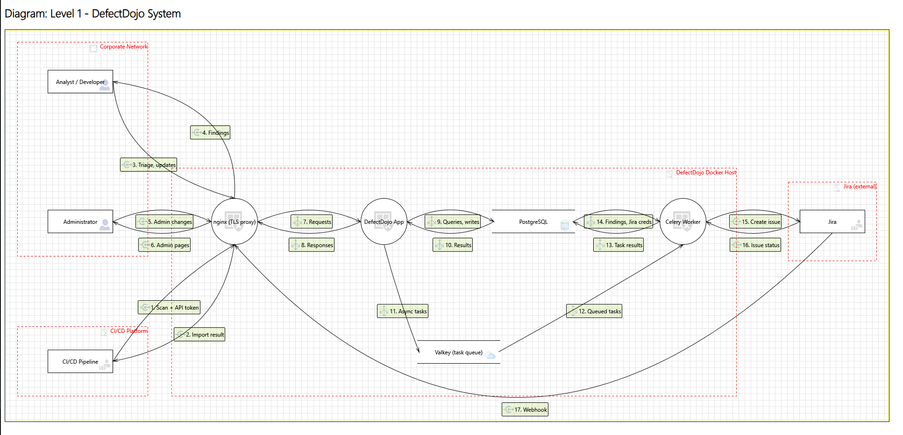

# Threat Modeling for Software Security Engineering

**Team 5**

| Member | Role |
|---|---|
| Ray Donner | Contributor |
| Grant Nichter | Team Lead |
| Alex Bahwawsi | Contributor |
| Chandler Crist | Contributor |

**Team GitHub Repository:** [github.com/creepysmilejpg/SWADjangoProject](https://github.com/creepysmilejpg/SWADjangoProject)

Task assignments, discussion, and progress tracking for this project are managed through the repository's GitHub Project Board, where issues are linked to board cards and closed only after review/comment.

---

# Part 1
## 1. Data flow diagrams for critical data flows

The DFDs below support the five scenarios prioritized in the Security Requirements and Assurance Case assignments. They were drawn in the Microsoft Threat Modeling Tool (TMT) using the Azure Threat Model Template. One Level 1 diagram shows the DefectDojo container architecture across all five scenarios. Two Level 2 diagrams decompose the Django application into the components that enforce authentication, authorization, auditing, and the Jira integration.

| Scenario | Interaction (from Requirements assignment) | Assurance claim | Covered by |
|---|---|---|---|
| S1 | CI/CD pipeline imports scan results through the API | Claim 1 | Level 1, Level 2 (Import, Triage, Remediation) |
| S2 | Security analyst triages findings and records risk acceptance | Claim 2 | Level 1, Level 2 (Import, Triage, Remediation) |
| S3 | Developer views and remediates findings for their own asset | Claim 3 | Level 1, Level 2 (Import, Triage, Remediation) |
| S4 | Administrator manages users and access | Claim 4 | Level 1, Level 2 (Administration and Jira) |
| S5 | DefectDojo pushes findings to Jira | Claim 5 | Level 1, Level 2 (Administration and Jira) |

**Trust boundaries used in the DFDs**

| Trust boundary | What it separates |
|---|---|
| Corporate Network | Human users (analysts, developers, administrators) and their browsers |
| CI/CD Platform | The pipeline and security scanners that call the DefectDojo API |
| DefectDojo Docker Host | The containers of the default Docker Compose deployment; only nginx publishes ports |
| Django Application | The uWSGI process that performs authentication, authorization, and business logic (Level 2 only) |
| Jira (external) | The Atlassian Jira service that receives pushed findings and sends webhooks |

### Level 1: DefectDojo System

The Level 1 DFD shows the five external interactors reaching DefectDojo through nginx (TLS termination), the Django application reading and writing PostgreSQL, asynchronous work passing through the Valkey task queue to the Celery worker, and the Celery worker exchanging data with Jira. The Jira webhook is the only flow that enters DefectDojo from an external service without a user session.

### Level 2: Scan Import, Triage, and Remediation (S1-S3)

Every request passes through Authentication (session cookie or API token, checked against Users & API Tokens) and then Authorization (checked against the Authorized Users lists) before reaching Findings Views or the Import Engine. Triage changes made in Findings Views are written to the Findings DB and recorded in the Audit Log.

### Level 2: Administration and Jira Integration (S4-S5)

Administrator requests pass through Authentication and a staff/superuser Authorization check before reaching User & Access Management or Jira Config. Two design points from earlier assignments are visible here. Access-list changes are written to Authorized Users without a corresponding audit event. The Jira webhook reaches the Webhook Handler without passing through Authentication, so it is protected only by the shared secret in the URL.

---

## 2. Threat analysis using the Microsoft Threat Modeling Tool

### Method

Threats were generated automatically by TMT's Analysis View for the Level 1 and Level 2 diagrams. Each threat was reviewed and assigned one of three states:

- **Mitigated:** DefectDojo or the deployment already addresses the threat; the justification names the control.
- **Needs Investigation:** the threat is relevant and not fully addressed; a mitigation strategy is documented.
- **Not Applicable:** the threat does not apply to this deployment; the justification explains why.

States were assigned by checking each threat against the DefectDojo `master` branch (commit `149270c`, reviewed November 20, 2026) and the default Docker Compose configuration; the evidence is summarized in Part 2. Because the model uses the Azure template, TMT words every data-store threat for Azure SQL or an Azure storage account. We judged the underlying risk against the PostgreSQL and Valkey containers actually modeled, and marked a threat Not Applicable only when it has no equivalent outside Azure. The per-threat reasoning is in the [Issue #12 threat review](./threat-modeling/Issue12_TMT_Threat_Review.md). The states below are our review decisions; the exported HTML report was generated before the review and still shows every threat as Not Started.

| Diagram | Threats generated | Mitigated | Needs Investigation | Not Applicable |
|---|---|---|---|---|
| Level 1 - DefectDojo System | 19 | 4 | 13 | 2 |
| Level 2 - Import, Triage, Remediation | 27 | 9 | 15 | 3 |
| Level 2 - Administration and Jira | 45 | 12 | 28 | 5 |
| **Total** | **91** | **25** | **56** | **10** |

| STRIDE category | Count |
|---|---|
| Spoofing | 0 |
| Tampering | 20 |
| Repudiation | 10 |
| Information Disclosure | 20 |
| Denial of Service | 0 |
| Elevation of Privilege | 41 |

### Threats on flows that cross trust boundaries

These flows cross a trust boundary in the DFDs, so their threats are reviewed first and in the most detail.

| Diagram | Flow | Boundary crossed | Why it matters |
|---|---|---|---|
| Level 1 | 1-2 Scan + API token / Import result | CI/CD Platform → Docker Host | A stolen pipeline token can import or alter findings (Claim 1) |
| Level 1 | 3-6 User and admin requests | Corporate Network → Docker Host | Session theft or credential guessing against local accounts; no MFA in OSS |
| Level 1 | 15-16 Create issue / Issue status | Docker Host ↔ Jira | Jira credentials leave DefectDojo; responses are trusted |
| Level 1 | 17 Webhook | Jira → Docker Host | Unauthenticated inbound call protected only by a URL secret |
| Level 2 (Import) | 5 Cookie / token | nginx → Django Application | Entry point for all authentication decisions |
| Level 2 (Import) | 11-14 Triage writes, Finding data, Change history, New findings | Django Application ↔ data stores | Integrity of findings and completeness of the audit trail (Claim 2) |
| Level 2 (Admin) | 7-9 User changes, Access changes, Audit events | Django Application → data stores | Access-list changes are not audited (Claim 4) |
| Level 2 (Admin) | 11-12 Jira creds, secret | Django Application → Jira Settings → Push Worker | Jira password stored unencrypted (Claim 5) |
| Level 2 (Admin) | 16-17 Webhook / Webhook (no login) | Jira → nginx → Webhook Handler | Bypasses Authentication entirely (Claim 5) |
| Level 2 (Admin) | 19 Status sync | Django Application → Findings DB | Webhook-driven status changes reach findings without a user session (Claim 5) |

TMT generated threats only for flows that end at a data store. Of the boundary-crossing flows above, that covers the eight flows from the Django Application to its data stores in the two Level 2 diagrams (Import flows 11, 13, 14 and Admin flows 7, 8, 9, 11, 19), which account for 72 of the 91 threats. The 64 that apply are listed here; the other 8 are Azure-only and appear under Not Applicable. TMT generated nothing for the flows that cross the Corporate Network, CI/CD Platform, or Jira boundaries (Level 1 flows 1-6 and 15-17; Level 2 flows 5, 12, 16, 17). We identified the threats on those flows ourselves from the earlier assignments, and they are reviewed under "Mitigations for flows that cross a trust boundary" in Part 2 and as M10 in Section 3.

Titles are copied from the HTML report as generated. For Mitigated threats the last column gives the justification; for Needs Investigation it gives the mitigation strategy. The M numbers refer to Section 3.

| TMT ID | Threat title | STRIDE | Flow / element | State | Mitigation strategy |
|---|---|---|---|---|---|
| 20 | An adversary can tamper critical database securables and deny the action | Tampering | L2 Import: 11. Triage writes → Findings DB | Needs Investigation | **M4.** All containers connect as one PostgreSQL superuser, so nothing at the database layer rejects an unauthorized write. Give the application and workers a non-superuser role with DML rights only, keep a separate owner role for migrations, and schedule tested backups. |
| 21 | An adversary may leverage the lack of monitoring systems and trigger anamolous traffic to database | Tampering | L2 Import: 11. Triage writes → Findings DB | Needs Investigation | **M9.** No monitoring or alerting ships with OSS. Enable PostgreSQL connection and statement logging and forward it, with the nginx and application logs and the pghistory events, to a SIEM that alerts on failed-login spikes, bulk changes, and privileged changes. |
| 22 | An adversary can deny actions on database due to lack of auditing | Repudiation | L2 Import: 11. Triage writes → Findings DB | Mitigated | **M3.** pghistory records every insert, update, and delete on `Finding`, `Test`, `Engagement`, and `Risk_Acceptance` with the acting user and source address (`dojo/auditlog/services.py`, `PgHistoryMiddleware`); on by default. |
| 23 | An adversary can gain access to sensitive PII or HBI data in Findings DB | Information Disclosure | L2 Import: 11. Triage writes → Findings DB | Needs Investigation | **M7.** No TLS on the database connection and no at-rest encryption in the default stack. Set `sslmode=require` in `DD_DATABASE_URL` where the database is not on the same host, and encrypt the PostgreSQL volume and backups. |
| 24 | An adversary can gain access to sensitive data by performing SQL injection | Information Disclosure | L2 Import: 11. Triage writes → Findings DB | Mitigated | **M2.** Data access is through the Django ORM, and the raw-SQL call sites we reviewed bind values as parameters. Keep this as a code-review rule for new raw SQL. |
| 25 | An adversary can gain unauthorized access to database due to lack of network access protection | Elevation of Privilege | L2 Import: 11. Triage writes → Findings DB | Mitigated | **M1.** In `docker-compose.yml` only nginx publishes ports; this data store is reachable only on the Compose network. Keep a host firewall as defence in depth. |
| 26 | An adversary can gain unauthorized access to Azure SQL database due to weak account policy | Elevation of Privilege | L2 Import: 11. Triage writes → Findings DB | Needs Investigation | **M6.** The stock Compose file uses `defectdojo`/`defectdojo` for the database and fixed fallback values for `DD_SECRET_KEY` and `DD_CREDENTIAL_AES_256_KEY`. Replace all of them with generated secrets supplied through Docker secrets (`DD_*_FILE`) and rotate on exposure. |
| 27 | An adversary can gain unauthorized access to Findings DB due to loose authorization rules | Elevation of Privilege | L2 Import: 11. Triage writes → Findings DB | Needs Investigation | **M4.** Application authorization (`authorized_users`, staff, superuser) is enforced for every view, but the database role behind it is a superuser shared by all containers. Apply the least-privilege role; role separation inside an Asset needs Pro or a compensating account practice. |
| 29 | An adversary can tamper critical database securables and deny the action | Tampering | L2 Import: 13. Change history → Audit Log | Needs Investigation | **M4.** All containers connect as one PostgreSQL superuser, so nothing at the database layer rejects an unauthorized write. Give the application and workers a non-superuser role with DML rights only, keep a separate owner role for migrations, and schedule tested backups. |
| 30 | An adversary may leverage the lack of monitoring systems and trigger anamolous traffic to database | Tampering | L2 Import: 13. Change history → Audit Log | Needs Investigation | **M9.** No monitoring or alerting ships with OSS. Enable PostgreSQL connection and statement logging and forward it, with the nginx and application logs and the pghistory events, to a SIEM that alerts on failed-login spikes, bulk changes, and privileged changes. |
| 31 | An adversary can deny actions on database due to lack of auditing | Repudiation | L2 Import: 13. Change history → Audit Log | Mitigated | **M3.** This flow is the audit write itself: pghistory triggers write the change history in the same transaction as the change, with the acting user and source address. |
| 32 | An adversary can gain access to sensitive PII or HBI data in Audit Log | Information Disclosure | L2 Import: 13. Change history → Audit Log | Needs Investigation | **M7.** Event tables hold copies of finding and user data. Restrict read access to them and to backups, and encrypt the PostgreSQL volume and backup files. |
| 33 | An adversary can gain access to sensitive data by performing SQL injection | Information Disclosure | L2 Import: 13. Change history → Audit Log | Mitigated | **M2.** Data access is through the Django ORM, and the raw-SQL call sites we reviewed bind values as parameters. Keep this as a code-review rule for new raw SQL. |
| 34 | An adversary can gain unauthorized access to database due to lack of network access protection | Elevation of Privilege | L2 Import: 13. Change history → Audit Log | Mitigated | **M1.** In `docker-compose.yml` only nginx publishes ports; this data store is reachable only on the Compose network. Keep a host firewall as defence in depth. |
| 35 | An adversary can gain unauthorized access to Azure SQL database due to weak account policy | Elevation of Privilege | L2 Import: 13. Change history → Audit Log | Needs Investigation | **M6.** The stock Compose file uses `defectdojo`/`defectdojo` for the database and fixed fallback values for `DD_SECRET_KEY` and `DD_CREDENTIAL_AES_256_KEY`. Replace all of them with generated secrets supplied through Docker secrets (`DD_*_FILE`) and rotate on exposure. |
| 36 | An adversary can gain unauthorized access to Audit Log due to loose authorization rules | Elevation of Privilege | L2 Import: 13. Change history → Audit Log | Needs Investigation | **M4.** Application authorization (`authorized_users`, staff, superuser) is enforced for every view, but the database role behind it is a superuser shared by all containers. Apply the least-privilege role; role separation inside an Asset needs Pro or a compensating account practice. |
| 38 | An adversary can tamper critical database securables and deny the action | Tampering | L2 Import: 14. New findings → Findings DB | Needs Investigation | **M4.** All containers connect as one PostgreSQL superuser, so nothing at the database layer rejects an unauthorized write. Give the application and workers a non-superuser role with DML rights only, keep a separate owner role for migrations, and schedule tested backups. |
| 39 | An adversary may leverage the lack of monitoring systems and trigger anamolous traffic to database | Tampering | L2 Import: 14. New findings → Findings DB | Needs Investigation | **M9.** No monitoring or alerting ships with OSS. Enable PostgreSQL connection and statement logging and forward it, with the nginx and application logs and the pghistory events, to a SIEM that alerts on failed-login spikes, bulk changes, and privileged changes. |
| 40 | An adversary can deny actions on database due to lack of auditing | Repudiation | L2 Import: 14. New findings → Findings DB | Mitigated | **M3.** pghistory records every insert, update, and delete on `Finding`, `Test`, `Engagement`, and `Risk_Acceptance` with the acting user and source address (`dojo/auditlog/services.py`, `PgHistoryMiddleware`); on by default. |
| 41 | An adversary can gain access to sensitive PII or HBI data in Findings DB | Information Disclosure | L2 Import: 14. New findings → Findings DB | Needs Investigation | **M7.** No TLS on the database connection and no at-rest encryption in the default stack. Set `sslmode=require` in `DD_DATABASE_URL` where the database is not on the same host, and encrypt the PostgreSQL volume and backups. |
| 42 | An adversary can gain access to sensitive data by performing SQL injection | Information Disclosure | L2 Import: 14. New findings → Findings DB | Mitigated | **M2.** Data access is through the Django ORM, and the raw-SQL call sites we reviewed bind values as parameters. Keep this as a code-review rule for new raw SQL. |
| 43 | An adversary can gain unauthorized access to database due to lack of network access protection | Elevation of Privilege | L2 Import: 14. New findings → Findings DB | Mitigated | **M1.** In `docker-compose.yml` only nginx publishes ports; this data store is reachable only on the Compose network. Keep a host firewall as defence in depth. |
| 44 | An adversary can gain unauthorized access to Azure SQL database due to weak account policy | Elevation of Privilege | L2 Import: 14. New findings → Findings DB | Needs Investigation | **M6.** The stock Compose file uses `defectdojo`/`defectdojo` for the database and fixed fallback values for `DD_SECRET_KEY` and `DD_CREDENTIAL_AES_256_KEY`. Replace all of them with generated secrets supplied through Docker secrets (`DD_*_FILE`) and rotate on exposure. |
| 45 | An adversary can gain unauthorized access to Findings DB due to loose authorization rules | Elevation of Privilege | L2 Import: 14. New findings → Findings DB | Needs Investigation | **M4.** Application authorization (`authorized_users`, staff, superuser) is enforced for every view, but the database role behind it is a superuser shared by all containers. Apply the least-privilege role; role separation inside an Asset needs Pro or a compensating account practice. |
| 47 | An adversary can tamper critical database securables and deny the action | Tampering | L2 Admin: 11. Jira creds, secret → Jira Settings | Needs Investigation | **M4.** All containers connect as one PostgreSQL superuser, so nothing at the database layer rejects an unauthorized write. Give the application and workers a non-superuser role with DML rights only, keep a separate owner role for migrations, and schedule tested backups. |
| 48 | An adversary may leverage the lack of monitoring systems and trigger anamolous traffic to database | Tampering | L2 Admin: 11. Jira creds, secret → Jira Settings | Needs Investigation | **M9.** No monitoring or alerting ships with OSS. Enable PostgreSQL connection and statement logging and forward it, with the nginx and application logs and the pghistory events, to a SIEM that alerts on failed-login spikes, bulk changes, and privileged changes. |
| 49 | An adversary can deny actions on database due to lack of auditing | Repudiation | L2 Admin: 11. Jira creds, secret → Jira Settings | Needs Investigation | **M5.** `JIRA_Instance` and `System_Settings` are not tracked, so changes to Jira credentials or the webhook-secret toggle leave no history. Register both models with pghistory. |
| 50 | An adversary can gain access to sensitive PII or HBI data in Jira Settings | Information Disclosure | L2 Admin: 11. Jira creds, secret → Jira Settings | Needs Investigation | **M7.** `JIRA_Instance.password` is stored in plaintext. Encrypt it with `dojo_crypto_encrypt()` as tool configurations already are; until then, use a dedicated low-privilege Jira API token and restrict database and backup access. |
| 51 | An adversary can gain access to sensitive data by performing SQL injection | Information Disclosure | L2 Admin: 11. Jira creds, secret → Jira Settings | Mitigated | **M2.** Data access is through the Django ORM, and the raw-SQL call sites we reviewed bind values as parameters. Keep this as a code-review rule for new raw SQL. |
| 52 | An adversary can gain unauthorized access to database due to lack of network access protection | Elevation of Privilege | L2 Admin: 11. Jira creds, secret → Jira Settings | Mitigated | **M1.** In `docker-compose.yml` only nginx publishes ports; this data store is reachable only on the Compose network. Keep a host firewall as defence in depth. |
| 53 | An adversary can gain unauthorized access to Azure SQL database due to weak account policy | Elevation of Privilege | L2 Admin: 11. Jira creds, secret → Jira Settings | Needs Investigation | **M6.** The stock Compose file uses `defectdojo`/`defectdojo` for the database and fixed fallback values for `DD_SECRET_KEY` and `DD_CREDENTIAL_AES_256_KEY`. Replace all of them with generated secrets supplied through Docker secrets (`DD_*_FILE`) and rotate on exposure. |
| 54 | An adversary can gain unauthorized access to Jira Settings due to loose authorization rules | Elevation of Privilege | L2 Admin: 11. Jira creds, secret → Jira Settings | Needs Investigation | **M4.** Application authorization (`authorized_users`, staff, superuser) is enforced for every view, but the database role behind it is a superuser shared by all containers. Apply the least-privilege role; role separation inside an Asset needs Pro or a compensating account practice. |
| 56 | An adversary can tamper critical database securables and deny the action | Tampering | L2 Admin: 19. Status sync → Findings DB | Needs Investigation | **M4.** All containers connect as one PostgreSQL superuser, so nothing at the database layer rejects an unauthorized write. Give the application and workers a non-superuser role with DML rights only, keep a separate owner role for migrations, and schedule tested backups. |
| 57 | An adversary may leverage the lack of monitoring systems and trigger anamolous traffic to database | Tampering | L2 Admin: 19. Status sync → Findings DB | Needs Investigation | **M9.** No monitoring or alerting ships with OSS. Enable PostgreSQL connection and statement logging and forward it, with the nginx and application logs and the pghistory events, to a SIEM that alerts on failed-login spikes, bulk changes, and privileged changes. |
| 58 | An adversary can deny actions on database due to lack of auditing | Repudiation | L2 Admin: 19. Status sync → Findings DB | Mitigated | **M3.** The webhook handler runs inside `pghistory.context(source="jira_webhook")`, so finding status changes made by status sync are recorded and attributable to the webhook. |
| 59 | An adversary can gain access to sensitive PII or HBI data in Findings DB | Information Disclosure | L2 Admin: 19. Status sync → Findings DB | Needs Investigation | **M7.** No TLS on the database connection and no at-rest encryption in the default stack. Set `sslmode=require` in `DD_DATABASE_URL` where the database is not on the same host, and encrypt the PostgreSQL volume and backups. |
| 60 | An adversary can gain access to sensitive data by performing SQL injection | Information Disclosure | L2 Admin: 19. Status sync → Findings DB | Mitigated | **M2.** Data access is through the Django ORM, and the raw-SQL call sites we reviewed bind values as parameters. Keep this as a code-review rule for new raw SQL. |
| 61 | An adversary can gain unauthorized access to database due to lack of network access protection | Elevation of Privilege | L2 Admin: 19. Status sync → Findings DB | Mitigated | **M1.** In `docker-compose.yml` only nginx publishes ports; this data store is reachable only on the Compose network. Keep a host firewall as defence in depth. |
| 62 | An adversary can gain unauthorized access to Azure SQL database due to weak account policy | Elevation of Privilege | L2 Admin: 19. Status sync → Findings DB | Needs Investigation | **M6.** The stock Compose file uses `defectdojo`/`defectdojo` for the database and fixed fallback values for `DD_SECRET_KEY` and `DD_CREDENTIAL_AES_256_KEY`. Replace all of them with generated secrets supplied through Docker secrets (`DD_*_FILE`) and rotate on exposure. |
| 63 | An adversary can gain unauthorized access to Findings DB due to loose authorization rules | Elevation of Privilege | L2 Admin: 19. Status sync → Findings DB | Needs Investigation | **M4.** Application authorization (`authorized_users`, staff, superuser) is enforced for every view, but the database role behind it is a superuser shared by all containers. Apply the least-privilege role; role separation inside an Asset needs Pro or a compensating account practice. |
| 65 | An adversary can tamper critical database securables and deny the action | Tampering | L2 Admin: 7. User changes → Users & API Tokens | Needs Investigation | **M4.** All containers connect as one PostgreSQL superuser, so nothing at the database layer rejects an unauthorized write. Give the application and workers a non-superuser role with DML rights only, keep a separate owner role for migrations, and schedule tested backups. |
| 66 | An adversary may leverage the lack of monitoring systems and trigger anamolous traffic to database | Tampering | L2 Admin: 7. User changes → Users & API Tokens | Needs Investigation | **M9.** No monitoring or alerting ships with OSS. Enable PostgreSQL connection and statement logging and forward it, with the nginx and application logs and the pghistory events, to a SIEM that alerts on failed-login spikes, bulk changes, and privileged changes. |
| 67 | An adversary can deny actions on database due to lack of auditing | Repudiation | L2 Admin: 7. User changes → Users & API Tokens | Mitigated | **M3.** `Dojo_User` is tracked by pghistory (password field excluded), so account creation and staff/superuser flag changes are recorded with the acting administrator. |
| 68 | An adversary can gain access to sensitive PII or HBI data in Users & API Tokens | Information Disclosure | L2 Admin: 7. User changes → Users & API Tokens | Needs Investigation | **M7.** Passwords are Argon2-hashed, but API tokens are stored in clear text and do not expire by default. Set `DD_API_TOKEN_DEFAULT_EXPIRY_DAYS`, rotate pipeline tokens, and restrict database and backup access. |
| 69 | An adversary can gain access to sensitive data by performing SQL injection | Information Disclosure | L2 Admin: 7. User changes → Users & API Tokens | Mitigated | **M2.** Data access is through the Django ORM, and the raw-SQL call sites we reviewed bind values as parameters. Keep this as a code-review rule for new raw SQL. |
| 70 | An adversary can gain unauthorized access to database due to lack of network access protection | Elevation of Privilege | L2 Admin: 7. User changes → Users & API Tokens | Mitigated | **M1.** In `docker-compose.yml` only nginx publishes ports; this data store is reachable only on the Compose network. Keep a host firewall as defence in depth. |
| 71 | An adversary can gain unauthorized access to Azure SQL database due to weak account policy | Elevation of Privilege | L2 Admin: 7. User changes → Users & API Tokens | Needs Investigation | **M6.** The stock Compose file uses `defectdojo`/`defectdojo` for the database and fixed fallback values for `DD_SECRET_KEY` and `DD_CREDENTIAL_AES_256_KEY`. Replace all of them with generated secrets supplied through Docker secrets (`DD_*_FILE`) and rotate on exposure. |
| 72 | An adversary can gain unauthorized access to Users & API Tokens due to loose authorization rules | Elevation of Privilege | L2 Admin: 7. User changes → Users & API Tokens | Needs Investigation | **M4.** Application authorization (`authorized_users`, staff, superuser) is enforced for every view, but the database role behind it is a superuser shared by all containers. Apply the least-privilege role; role separation inside an Asset needs Pro or a compensating account practice. |
| 74 | An adversary can tamper critical database securables and deny the action | Tampering | L2 Admin: 8. Access changes → Authorized Users | Needs Investigation | **M4.** All containers connect as one PostgreSQL superuser, so nothing at the database layer rejects an unauthorized write. Give the application and workers a non-superuser role with DML rights only, keep a separate owner role for migrations, and schedule tested backups. |
| 75 | An adversary may leverage the lack of monitoring systems and trigger anamolous traffic to database | Tampering | L2 Admin: 8. Access changes → Authorized Users | Needs Investigation | **M9.** No monitoring or alerting ships with OSS. Enable PostgreSQL connection and statement logging and forward it, with the nginx and application logs and the pghistory events, to a SIEM that alerts on failed-login spikes, bulk changes, and privileged changes. |
| 76 | An adversary can deny actions on database due to lack of auditing | Repudiation | L2 Admin: 8. Access changes → Authorized Users | Needs Investigation | **M5.** Adding or removing a user on an `authorized_users` list writes no audit event. Register the `Product` and `Product_Type` through tables with pghistory, as is already done for `Finding.reviewers`. |
| 77 | An adversary can gain access to sensitive PII or HBI data in Authorized Users | Information Disclosure | L2 Admin: 8. Access changes → Authorized Users | Needs Investigation | **M7.** No TLS on the database connection and no at-rest encryption in the default stack. Set `sslmode=require` in `DD_DATABASE_URL` where the database is not on the same host, and encrypt the PostgreSQL volume and backups. |
| 78 | An adversary can gain access to sensitive data by performing SQL injection | Information Disclosure | L2 Admin: 8. Access changes → Authorized Users | Mitigated | **M2.** Data access is through the Django ORM, and the raw-SQL call sites we reviewed bind values as parameters. Keep this as a code-review rule for new raw SQL. |
| 79 | An adversary can gain unauthorized access to database due to lack of network access protection | Elevation of Privilege | L2 Admin: 8. Access changes → Authorized Users | Mitigated | **M1.** In `docker-compose.yml` only nginx publishes ports; this data store is reachable only on the Compose network. Keep a host firewall as defence in depth. |
| 80 | An adversary can gain unauthorized access to Azure SQL database due to weak account policy | Elevation of Privilege | L2 Admin: 8. Access changes → Authorized Users | Needs Investigation | **M6.** The stock Compose file uses `defectdojo`/`defectdojo` for the database and fixed fallback values for `DD_SECRET_KEY` and `DD_CREDENTIAL_AES_256_KEY`. Replace all of them with generated secrets supplied through Docker secrets (`DD_*_FILE`) and rotate on exposure. |
| 81 | An adversary can gain unauthorized access to Authorized Users due to loose authorization rules | Elevation of Privilege | L2 Admin: 8. Access changes → Authorized Users | Needs Investigation | **M4, M5.** Membership changes require staff or member-management permission in the application, but the database role is a superuser and the change is not audited. Apply the least-privilege role and the audit fix, and keep the staff list short. |
| 83 | An adversary can tamper critical database securables and deny the action | Tampering | L2 Admin: 9. Audit events → Audit Log | Needs Investigation | **M4.** All containers connect as one PostgreSQL superuser, so nothing at the database layer rejects an unauthorized write. Give the application and workers a non-superuser role with DML rights only, keep a separate owner role for migrations, and schedule tested backups. |
| 84 | An adversary may leverage the lack of monitoring systems and trigger anamolous traffic to database | Tampering | L2 Admin: 9. Audit events → Audit Log | Needs Investigation | **M9.** No monitoring or alerting ships with OSS. Enable PostgreSQL connection and statement logging and forward it, with the nginx and application logs and the pghistory events, to a SIEM that alerts on failed-login spikes, bulk changes, and privileged changes. |
| 85 | An adversary can deny actions on database due to lack of auditing | Repudiation | L2 Admin: 9. Audit events → Audit Log | Needs Investigation | **M4, M5.** The audit tables are writable by the application's own database role, and the recorded source address comes from the client's `X-Forwarded-For` header. Make the event tables insert-only for the application role, have nginx overwrite the header, and copy events off-host. |
| 86 | An adversary can gain access to sensitive PII or HBI data in Audit Log | Information Disclosure | L2 Admin: 9. Audit events → Audit Log | Needs Investigation | **M7.** Event tables hold copies of finding and user data. Restrict read access to them and to backups, and encrypt the PostgreSQL volume and backup files. |
| 87 | An adversary can gain access to sensitive data by performing SQL injection | Information Disclosure | L2 Admin: 9. Audit events → Audit Log | Mitigated | **M2.** Data access is through the Django ORM, and the raw-SQL call sites we reviewed bind values as parameters. Keep this as a code-review rule for new raw SQL. |
| 88 | An adversary can gain unauthorized access to database due to lack of network access protection | Elevation of Privilege | L2 Admin: 9. Audit events → Audit Log | Mitigated | **M1.** In `docker-compose.yml` only nginx publishes ports; this data store is reachable only on the Compose network. Keep a host firewall as defence in depth. |
| 89 | An adversary can gain unauthorized access to Azure SQL database due to weak account policy | Elevation of Privilege | L2 Admin: 9. Audit events → Audit Log | Needs Investigation | **M6.** The stock Compose file uses `defectdojo`/`defectdojo` for the database and fixed fallback values for `DD_SECRET_KEY` and `DD_CREDENTIAL_AES_256_KEY`. Replace all of them with generated secrets supplied through Docker secrets (`DD_*_FILE`) and rotate on exposure. |
| 90 | An adversary can gain unauthorized access to Audit Log due to loose authorization rules | Elevation of Privilege | L2 Admin: 9. Audit events → Audit Log | Needs Investigation | **M4.** Application authorization (`authorized_users`, staff, superuser) is enforced for every view, but the database role behind it is a superuser shared by all containers. Apply the least-privilege role; role separation inside an Asset needs Pro or a compensating account practice. |

### Other relevant threats

The remaining applicable threats are all in the Level 1 diagram, on three flows that stay inside the DefectDojo Docker Host boundary: 9 (DefectDojo App to PostgreSQL), 11 (DefectDojo App to Valkey), and 13 (Celery Worker to PostgreSQL).

| TMT ID | Threat title | STRIDE | Flow / element | State | Mitigation strategy |
|---|---|---|---|---|---|
| 1 | An adversary may gain unauthorized access to Valkey (task queue) account in a subscription | Elevation of Privilege | L1: 11. Async tasks → Valkey (task queue) | Needs Investigation | **M8.** Network isolation and JSON-only Celery serialization are in place, but Valkey has no password or ACL. Set `requirepass` (or an ACL user) and put the credentials in `DD_CELERY_BROKER_URL` and `DD_CACHE_URL`; keep the port unpublished. |
| 2 | An adversary can tamper critical database securables and deny the action | Tampering | L1: 13. Task results → PostgreSQL | Needs Investigation | **M4.** All containers connect as one PostgreSQL superuser, so nothing at the database layer rejects an unauthorized write. Give the application and workers a non-superuser role with DML rights only, keep a separate owner role for migrations, and schedule tested backups. |
| 3 | An adversary may leverage the lack of monitoring systems and trigger anamolous traffic to database | Tampering | L1: 13. Task results → PostgreSQL | Needs Investigation | **M9.** No monitoring or alerting ships with OSS. Enable PostgreSQL connection and statement logging and forward it, with the nginx and application logs and the pghistory events, to a SIEM that alerts on failed-login spikes, bulk changes, and privileged changes. |
| 4 | An adversary can deny actions on database due to lack of auditing | Repudiation | L1: 13. Task results → PostgreSQL | Needs Investigation | **M5.** Finding, user, and risk-acceptance writes on this flow are audited, but access-list, Jira, and system-setting writes are not. Extend pghistory coverage and ship the events off-host. |
| 5 | An adversary can gain access to sensitive PII or HBI data in PostgreSQL | Information Disclosure | L1: 13. Task results → PostgreSQL | Needs Investigation | **M7.** No TLS on the database connection and no at-rest encryption in the default stack. Set `sslmode=require` in `DD_DATABASE_URL` where the database is not on the same host, and encrypt the PostgreSQL volume and backups. |
| 6 | An adversary can gain access to sensitive data by performing SQL injection | Information Disclosure | L1: 13. Task results → PostgreSQL | Mitigated | **M2.** Data access is through the Django ORM, and the raw-SQL call sites we reviewed bind values as parameters. Keep this as a code-review rule for new raw SQL. |
| 7 | An adversary can gain unauthorized access to database due to lack of network access protection | Elevation of Privilege | L1: 13. Task results → PostgreSQL | Mitigated | **M1.** In `docker-compose.yml` only nginx publishes ports; this data store is reachable only on the Compose network. Keep a host firewall as defence in depth. |
| 8 | An adversary can gain unauthorized access to Azure SQL database due to weak account policy | Elevation of Privilege | L1: 13. Task results → PostgreSQL | Needs Investigation | **M6.** The stock Compose file uses `defectdojo`/`defectdojo` for the database and fixed fallback values for `DD_SECRET_KEY` and `DD_CREDENTIAL_AES_256_KEY`. Replace all of them with generated secrets supplied through Docker secrets (`DD_*_FILE`) and rotate on exposure. |
| 9 | An adversary can gain unauthorized access to PostgreSQL due to loose authorization rules | Elevation of Privilege | L1: 13. Task results → PostgreSQL | Needs Investigation | **M4.** Application authorization (`authorized_users`, staff, superuser) is enforced for every view, but the database role behind it is a superuser shared by all containers. Apply the least-privilege role; role separation inside an Asset needs Pro or a compensating account practice. |
| 11 | An adversary can tamper critical database securables and deny the action | Tampering | L1: 9. Queries, writes → PostgreSQL | Needs Investigation | **M4.** All containers connect as one PostgreSQL superuser, so nothing at the database layer rejects an unauthorized write. Give the application and workers a non-superuser role with DML rights only, keep a separate owner role for migrations, and schedule tested backups. |
| 12 | An adversary may leverage the lack of monitoring systems and trigger anamolous traffic to database | Tampering | L1: 9. Queries, writes → PostgreSQL | Needs Investigation | **M9.** No monitoring or alerting ships with OSS. Enable PostgreSQL connection and statement logging and forward it, with the nginx and application logs and the pghistory events, to a SIEM that alerts on failed-login spikes, bulk changes, and privileged changes. |
| 13 | An adversary can deny actions on database due to lack of auditing | Repudiation | L1: 9. Queries, writes → PostgreSQL | Needs Investigation | **M5.** Finding, user, and risk-acceptance writes on this flow are audited, but access-list, Jira, and system-setting writes are not. Extend pghistory coverage and ship the events off-host. |
| 14 | An adversary can gain access to sensitive PII or HBI data in PostgreSQL | Information Disclosure | L1: 9. Queries, writes → PostgreSQL | Needs Investigation | **M7.** No TLS on the database connection and no at-rest encryption in the default stack. Set `sslmode=require` in `DD_DATABASE_URL` where the database is not on the same host, and encrypt the PostgreSQL volume and backups. |
| 15 | An adversary can gain access to sensitive data by performing SQL injection | Information Disclosure | L1: 9. Queries, writes → PostgreSQL | Mitigated | **M2.** Data access is through the Django ORM, and the raw-SQL call sites we reviewed bind values as parameters. Keep this as a code-review rule for new raw SQL. |
| 16 | An adversary can gain unauthorized access to database due to lack of network access protection | Elevation of Privilege | L1: 9. Queries, writes → PostgreSQL | Mitigated | **M1.** In `docker-compose.yml` only nginx publishes ports; this data store is reachable only on the Compose network. Keep a host firewall as defence in depth. |
| 17 | An adversary can gain unauthorized access to Azure SQL database due to weak account policy | Elevation of Privilege | L1: 9. Queries, writes → PostgreSQL | Needs Investigation | **M6.** The stock Compose file uses `defectdojo`/`defectdojo` for the database and fixed fallback values for `DD_SECRET_KEY` and `DD_CREDENTIAL_AES_256_KEY`. Replace all of them with generated secrets supplied through Docker secrets (`DD_*_FILE`) and rotate on exposure. |
| 18 | An adversary can gain unauthorized access to PostgreSQL due to loose authorization rules | Elevation of Privilege | L1: 9. Queries, writes → PostgreSQL | Needs Investigation | **M4.** Application authorization (`authorized_users`, staff, superuser) is enforced for every view, but the database role behind it is a superuser shared by all containers. Apply the least-privilege role; role separation inside an Asset needs Pro or a compensating account practice. |

### Threats marked Not Applicable

All ten are the same template threat, generated once per database flow. It concerns access to an Azure subscription's management plane, and the modeled deployment is a single-host Docker Compose stack with no Azure subscription. The underlying risk of someone obtaining the database account is covered by the "weak account policy" and "loose authorization rules" threats on the same flow.

| TMT ID | Threat title | Reason not applicable |
|---|---|---|
| 10 | An adversary may gain unauthorized access to PostgreSQL account in a subscription | Azure subscription threat on L1: 13. Task results → PostgreSQL; no Azure subscription in this deployment. |
| 19 | An adversary may gain unauthorized access to PostgreSQL account in a subscription | Azure subscription threat on L1: 9. Queries, writes → PostgreSQL; no Azure subscription in this deployment. |
| 28 | An adversary may gain unauthorized access to Findings DB account in a subscription | Azure subscription threat on L2 Import: 11. Triage writes → Findings DB; no Azure subscription in this deployment. |
| 37 | An adversary may gain unauthorized access to Audit Log account in a subscription | Azure subscription threat on L2 Import: 13. Change history → Audit Log; no Azure subscription in this deployment. |
| 46 | An adversary may gain unauthorized access to Findings DB account in a subscription | Azure subscription threat on L2 Import: 14. New findings → Findings DB; no Azure subscription in this deployment. |
| 55 | An adversary may gain unauthorized access to Jira Settings account in a subscription | Azure subscription threat on L2 Admin: 11. Jira creds, secret → Jira Settings; no Azure subscription in this deployment. |
| 64 | An adversary may gain unauthorized access to Findings DB account in a subscription | Azure subscription threat on L2 Admin: 19. Status sync → Findings DB; no Azure subscription in this deployment. |
| 73 | An adversary may gain unauthorized access to Users & API Tokens account in a subscription | Azure subscription threat on L2 Admin: 7. User changes → Users & API Tokens; no Azure subscription in this deployment. |
| 82 | An adversary may gain unauthorized access to Authorized Users account in a subscription | Azure subscription threat on L2 Admin: 8. Access changes → Authorized Users; no Azure subscription in this deployment. |
| 91 | An adversary may gain unauthorized access to Audit Log account in a subscription | Azure subscription threat on L2 Admin: 9. Audit events → Audit Log; no Azure subscription in this deployment. |

---

## 3. Mitigation strategies

The 81 applicable threats reduce to nine mitigation strategies, plus a tenth for the boundary flows that TMT did not analyze. M1 to M3 are implemented by DefectDojo and are the basis for the 25 threats marked Mitigated. M4 to M9 are the strategies for the 56 threats marked Needs Investigation.

| # | Mitigation strategy | Threats addressed (TMT IDs) | Provided by | Related claim |
|---|---|---|---|---|
| M1 | Network isolation: only nginx publishes ports, and PostgreSQL and Valkey stay on the Compose network | 7, 16, 25, 34, 43, 52, 61, 70, 79, 88 | DefectDojo (default Compose file) | All |
| M2 | Parameterized data access through the Django ORM, with bound parameters in raw SQL | 6, 15, 24, 33, 42, 51, 60, 69, 78, 87 | DefectDojo | Claims 1, 3 |
| M3 | Audit history for findings, tests, engagements, risk acceptances, and users via django-pghistory, with acting user and source address | 22, 31, 40, 58, 67 | DefectDojo (on by default; `DD_ENABLE_AUDITLOG`) | Claims 1, 2, 4 |
| M4 | Least-privilege PostgreSQL roles: a non-superuser application role, a separate migration owner, insert-only audit tables, and tested backups | 2, 9, 11, 18, 20, 27, 29, 36, 38, 45, 47, 54, 56, 63, 65, 72, 74, 81, 83, 85, 90 | Environment (PostgreSQL configuration; not the default) | Claims 2, 3, 4 |
| M5 | Extend audit coverage to `authorized_users` membership, `JIRA_Instance`, and `System_Settings`, and stop trusting the client-supplied `X-Forwarded-For` for the audit source address | 4, 13, 49, 76, 81, 85 | Code change (proposed upstream contribution) or Pro | Claims 4, 5 |
| M6 | Replace the default database password and fallback `DD_SECRET_KEY` / `DD_CREDENTIAL_AES_256_KEY` with generated secrets delivered as Docker secrets | 8, 17, 26, 35, 44, 53, 62, 71, 80, 89 | Configuration | Claims 1, 4, 5 |
| M7 | Protect sensitive data at rest and in transit: encrypt the Jira password, set API token expiry, use TLS to the database where it leaves the host, and encrypt the database volume and backups | 5, 14, 23, 32, 41, 50, 59, 68, 77, 86 | Code change (Jira password); Configuration (token expiry, `sslmode`); Environment (volume encryption) | Claims 1, 3, 5 |
| M8 | Authenticate the Valkey task queue with a password or ACL; keep JSON-only task serialization | 1 | Configuration (serialization is already DefectDojo default) | Claims 1, 5 |
| M9 | Central logging and alerting on database, proxy, application, and audit events | 3, 12, 21, 30, 39, 48, 57, 66, 75, 84 | Environment (SIEM) | Claims 2, 4 |
| M10 | Controls for the boundary flows TMT did not cover: the HTTPS override with `Secure` cookies and HSTS, the login rate limiter and lockout, MFA/SSO through an authenticating proxy or identity provider, and a rotated Jira webhook secret that is never disabled | None generated; identified manually (see Part 2) | Configuration (TLS, cookies, rate limiter, webhook secret); Pro or Environment (MFA/SSO) | Claims 1, 3, 4, 5 |

**Comparison with gaps from earlier assignments.** The TMT analysis reaches three of the four gaps we had already found, from a different direction. Unaudited access-list changes surface as the repudiation threat on the Access changes flow (76) and are addressed by M5. The plaintext Jira password surfaces as the information disclosure threat on the Jira creds, secret flow (50) and is addressed by M7. The absence of role separation appears only indirectly, in the "loose authorization rules" threats (M4), because TMT reasons about database permissions and not about roles inside the application; restoring it still requires Pro or a compensating account practice. The absence of MFA does not appear at all, because TMT generated no threats for the flows from the Corporate Network, so it is carried in M10. The analysis also added three concerns that the earlier assignments had not raised: every container shares one database superuser, the task queue has no authentication, and the stock deployment relies on default credentials and keys. Of the ten strategies, only M1 to M3 are in place without operator action, which matches the earlier conclusion that the OSS edition needs configuration and compensating controls before it meets our requirements.

---

## 4. TMT HTML report

**Full TMT report (rendered):** [DefectDojo Threat Model Report](https://htmlpreview.github.io/?https://github.com/creepysmilejpg/SWADjangoProject/blob/main/docs/DefectDojo_threat_report.html)

---

## 5. Team GitHub repository

**Repository:** [github.com/creepysmilejpg/SWADjangoProject](https://github.com/creepysmilejpg/SWADjangoProject) ([issues](https://github.com/creepysmilejpg/SWADjangoProject/issues), [project board](https://github.com/creepysmilejpg/SWADjangoProject/projects), [commit history](https://github.com/creepysmilejpg/SWADjangoProject/commits/main))

Work for this assignment was tracked as issues on the repository's Project Board. The commit history shows who delivered each part:

| Task | Owner | Artifacts |
|---|---|---|
| Assignment document, Level 1 and Level 2 DFDs, and the TMT HTML report | Grant Nichter | This document; `docs/diagrams/DFD_Level1_System.png`, `DFD_Level2_Import_Triage.png`, `DFD_Level2_Admin_Jira.png`; `docs/DefectDojo_threat_report.html` |
| Review of the automatically identified threats and proposed mitigations (Issue #12) | Chandler Crist | `docs/threat-modeling/Issue12_TMT_Threat_Review.md` |
| Review of the DefectDojo code for the expected mitigations, threat states, and mitigation strategies | Alex Bahwawsi | Sections 2 and 3 and Part 2, Section 1 of this document |
| Individual reflections | All members | Part 2, Section 2 |

As in the earlier assignments, cards were linked to their issues and closed only after review and comment by another member.

---

# Part 2: Observations and Reflection

## 1. Review of the OSS project for expected mitigations

### Scope and method

Part 1 and the [Issue #12 threat review](./threat-modeling/Issue12_TMT_Threat_Review.md) left us with a list of mitigations we *expected* DefectDojo to have: nine mitigation groups for the 91 TMT findings (codes **Q, I, T, L, D, S, N, P, A**), plus the controls for the boundary-crossing flows that TMT did not generate findings for (CI/CD token, user sessions, Jira credentials, Jira webhook, access-list changes). The Issue #12 review deliberately made no claim that any of them exist. This section checks them against the code.

We read the `master` branch of [django-DefectDojo](https://github.com/DefectDojo/django-DefectDojo) at commit `149270c` (`dojo/__init__.py` version 3.5.202, reviewed November 20, 2026), focusing on the default Docker Compose deployment that our DFDs model: `docker-compose.yml`, `docker-compose.override.https.yml`, `nginx/`, `Dockerfile.*`, `dojo/settings/settings.dist.py`, `dojo/auditlog/`, `dojo/authorization/`, `dojo/user/`, `dojo/jira/`, and the raw-SQL call sites under `dojo/`. This was a static review of code and default configuration. We did not deploy the stack or run tests, so "present" means the control is in the code and enabled by default, not that we confirmed it works.

| Status | Meaning |
|---|---|
| **Present** | Implemented in the OSS code and active in the default deployment. |
| **Partial** | Implemented but off by default, incomplete, or dependent on the operator changing a setting. |
| **Gap** | Not implemented in OSS; needs a code change, the Pro edition, or a control outside DefectDojo. |

### Mitigations for the TMT-generated threats (data stores and task queue)

| Code | Expected mitigation | What the project implements | Status |
|---|---|---|---|
| **N** | Only nginx reachable from outside the Docker host; PostgreSQL and Valkey not published | In `docker-compose.yml`, `nginx` is the only service with a `ports:` entry (8080 and 8443). `postgres` and `valkey` are reachable only on the Compose network. The Django and nginx images drop to a non-root user (`USER ${uid}`). | **Present** |
| **S** | Parameterized SQL; no query text built from untrusted input | Data access is through the Django ORM. The raw-SQL call sites we read (`dojo/tags/utils.py`, `dojo/finding/helper.py`, `dojo/finding/deduplication.py`, `dojo/endpoint/utils.py`, `dojo/importers/import_lock.py`) bind values with `%s` parameters and interpolate only table names taken from model metadata through `quote_name()`. The f-string SQL in `dojo/auditlog/backfill.py` and the `pghistory_*` management commands uses internal table names, not request data. | **Present** |
| **Q** | Valkey limited to the private network, with authentication and no code execution through queued messages | Network isolation is present (see N). Celery accepts JSON only (`CELERY_ACCEPT_CONTENT = ["json"]`, JSON task and result serializers), which removes the pickle deserialization route. There is no authentication: the default broker and cache URLs are `redis://valkey:6379/0` and `/1` with no password, the `valkey` service sets no `requirepass` or ACL, and there is no TLS between containers. | **Partial** |
| **P** | Strong, unique service credentials | The mechanism exists: every secret can be overridden by environment variable, and `docker/secret-file-loader.sh` loads `DD_*_FILE` variables from Docker secrets. The defaults are weak: the database user and password are both `defectdojo`, and `docker-compose.yml` ships fixed fallback values for `DD_SECRET_KEY` and `DD_CREDENTIAL_AES_256_KEY`. The file's header says it is not meant for production without customization, but nothing refuses to start with the defaults. | **Partial** |
| **A** | Least-privilege database roles; object-level authorization in the application | Application-level authorization is present and centralized in `dojo/authorization/authorization.py` (superuser, staff, or `authorized_users` membership up the object hierarchy). At the database layer there is no separation: `uwsgi`, `celeryworker`, `celerybeat`, and `initializer` all connect with the same `DD_DATABASE_URL`, and that account is the `POSTGRES_USER` the official image creates as a superuser. | **Gap** (database layer) |
| **I** | Unauthorized writes to findings, users, and audit records are rejected | In the application, writes pass through the authorization check above, CSRF middleware is enabled, and uploads are bounded (`DD_SCAN_FILE_MAX_SIZE`, the `DD_FILE_IMPORT_TYPES` allowlist, and the `DD_MAX_ZIP_*` limits). In the database, the single superuser role (see A) can modify any table, including the pghistory event tables and their triggers. The Compose file defines no backup job. | **Partial** |
| **L** | Sensitive changes are logged with actor, time, and object; logs are protected | `dojo/auditlog/services.py` registers `Dojo_User` (password excluded), `Finding`, `Finding_Group`, `Finding_Template`, `Risk_Acceptance`, `Test`, `Engagement`, `Product`, `Product_Type`, `Endpoint`, `Location`, `URL`, `Notification_Webhooks`, the `Finding.reviewers` through table, and the tag through tables with django-pghistory. `PgHistoryMiddleware` adds the acting user and source address, and `DD_ENABLE_AUDITLOG` defaults to `True`. Login, logout, and failed login are written to the application log with username and IP (`dojo/utils.py`). Not covered: the `authorized_users` through tables on `Product` and `Product_Type`, `JIRA_Instance`, and `System_Settings`. | **Partial** |
| **T** | Detection of and alerting on anomalous database or account activity | Raw material exists (pghistory events, the login log lines, the nginx access log), but nothing in OSS analyzes it. There is no alert on failed-login spikes, mass finding closure, or privileged changes, and PostgreSQL logging is left at the image defaults. | **Gap** |
| **D** | Sensitive records and credentials protected at rest and in transit | User passwords are hashed with Argon2 as the preferred hasher. `Tool_Configuration` credentials are encrypted with `dojo_crypto_encrypt()`. `JIRA_Instance.password` is a plain `CharField(max_length=2000)`, API tokens are stock DRF `Token` rows stored in clear text, and the connection to PostgreSQL has no `sslmode` configured. Volume and backup encryption are left to the host. | **Partial** |
| **C** | Azure subscription controls | Not applicable to this deployment, as recorded in the Issue #12 review. | N/A |

### Mitigations for flows that cross a trust boundary

TMT's Azure template generated no findings for these flows, but they are the ones our scenarios and assurance claims depend on, so we reviewed them against the mitigations we planned in the Requirements and Assurance Case assignments.

| Flow (DFD) | Expected mitigation | What the project implements | Status |
|---|---|---|---|
| CI/CD Platform → nginx → API (Level 1 flows 1-2) | Token bound to one account, limited lifetime, revocable; uploads validated before parsing | `ExpiringTokenAuthentication` (`dojo/user/authentication.py`) rejects expired tokens, with an instance default (`DD_API_TOKEN_DEFAULT_EXPIRY_DAYS`) and a per-user `token_expiry` override. The default is `0`, meaning tokens never expire. `DD_API_TOKENS_ENABLED` and `DD_API_TOKEN_AUTH_ENDPOINT_ENABLED` are working kill switches. Tokens carry the full rights of their user; there is no import-only scope. Upload size, type, and archive limits are enforced, and 36 parser modules import `defusedxml`; six import `lxml` or `xml.etree` directly and would need individual review. No DRF throttle classes are configured for the API. | **Partial** |
| Corporate Network → nginx (Level 1 flows 3-6) | TLS, hardened session cookies, brute-force protection, MFA | `nginx_TLS.conf` restricts to TLS 1.2/1.3 with the Mozilla intermediate cipher list and redirects 8080 to 8443, but it is used only with `docker-compose.override.https.yml`; the base file serves plain HTTP on 8080. Cookies are `HttpOnly` and `SameSite=Lax` by default; `Secure` is `False` unless the HTTPS override or the operator sets it. HSTS is applied only when `DD_SECURE_HSTS_INCLUDE_SUBDOMAINS` is true. Password complexity validators are on. The login rate limiter, blocking, and account lockout all default to `False`. `requirements.txt` contains no MFA, SAML, OAuth, or LDAP package. `DD_ALLOWED_HOSTS` defaults to `*` in the Compose file. | **Partial** (MFA: **Gap**) |
| Admin → User & Access Management → Authorized Users (Level 2 Admin flows 7-9) | Only administrators change access lists, and every change is audited | The views check authorization before changing membership (`is_staff` in `dojo/user/ui/views.py`, `Product_Manage_Members` in `dojo/product/ui/views.py`). The change itself is a bare `authorized_users.add()` / `.remove()` with no log line, notification, or pghistory event. | **Partial** (audit: **Gap**) |
| Django Application → Jira Settings → Push Worker → Jira (Level 2 Admin flows 11-12, Level 1 flows 15-16) | Jira credential encrypted at rest, never returned, admin-only | Configuration views require `user_has_configuration_permission`. The API serializer marks `password` write-only and the edit form does not render the stored value. The password itself is stored unencrypted, and `JIRA_Instance` changes are not audited. | **Partial** (encryption: **Gap**) |
| Jira → nginx → Webhook Handler (Level 1 flow 17, Level 2 Admin flows 16-17) | Inbound webhook authenticated before processing; ignored when the integration is off | `dojo/jira/views.py` accepts POST only, returns early when `enable_jira` or `enable_jira_web_hook` is off, and compares the URL path secret with `system_settings.jira_webhook_secret`. Processing runs inside a `pghistory.context(source="jira_webhook")`, so resulting finding changes are attributable to the webhook. The secret is a static value in the URL path (so it is written to the nginx access log, whose format includes `$request`), the comparison is a plain `!=`, there is no signature over the body, and `disable_jira_webhook_secret` turns the check off. | **Partial** |

### Gaps

The gaps below are ordered by how directly they undermine the mitigations we wrote down in Part 1.

1. **Access-list changes are still not audited.** This is the gap the Level 2 Administration DFD shows as a missing audit flow, and it is unchanged at this commit. The fix pattern already exists in the same file: `dojo/auditlog/services.py` tracks `Finding.reviewers` by registering a proxy of the many-to-many through model. Doing the same for `Product.authorized_users` and `Product_Type.authorized_users` would close it.
2. **Jira and system configuration sit outside the audit trail.** `JIRA_Instance` and `System_Settings` are not registered with pghistory. Our Assurance Case assignment listed this as "pending verification" (R5.5); it is now confirmed as a gap. One consequence: turning on `disable_jira_webhook_secret` removes webhook authentication and leaves no history event.
3. **The Jira password is stored in plaintext**, although an encryption helper is already used for tool configurations a few modules away. Mitigation **D** is therefore met for scanner credentials and not for the integration our misuse case targets.
4. **The audit trail can be altered with the application's own database account.** Because every container uses one superuser role, mitigations **A** and **I** have no database-layer support, and anything that compromises the Django or Celery process can rewrite pghistory tables. The audit source address also comes from the first `X-Forwarded-For` value, which the bundled nginx configuration passes through from the client rather than overwriting, so that field appears to be forgeable.
5. **Secure behaviour is opt-in.** Default database password, fixed fallback secret and AES keys, HTTP on 8080, `Secure` cookies off, HSTS off, rate limiting and lockout off, non-expiring API tokens, and `ALLOWED_HOSTS=*` are all defaults that an operator has to know to change. Each control exists, so these are configuration gaps, but a deployment built from the stock Compose file has almost none of the session and credential mitigations we assumed for the Corporate Network and CI/CD boundaries.
6. **The task queue has no authentication.** Network isolation and JSON-only serialization reduce the risk in **Q**, but any process on the Compose network can read or inject tasks.
7. **Webhook authentication is weak by design.** A path secret is logged by the proxy, cannot be rotated without reconfiguring Jira, and does not protect the request body.
8. **No MFA or SSO, and no detection.** Both were expected mitigations for the Corporate Network boundary and for **T**; both have to come from outside the OSS edition (an authenticating proxy or identity provider, and a SIEM reading the pghistory tables and logs).

Two findings from earlier assignments need correcting in light of this review. The Assurance Case alignment (E1.1.4) said OSS API tokens cannot expire; a token-expiry setting and per-user override do exist, and the actual gap is that expiry is off by default. The write-only behaviour of the Jira password in the API (R5.2) was listed as needing a test; the serializer does declare it write-only.

### Summary

Of the nine mitigation groups for the TMT-generated threats, two are present as expected (network exposure and SQL injection), five are partial, and two are gaps (database least privilege and anomaly detection). All five boundary-crossing flows are partial: each has a real control in the code, and each has at least one missing piece or an insecure default. The pattern is consistent with what we found in the Requirements and Assurance Case assignments. DefectDojo's application-layer controls (centralized authorization, finding and risk-acceptance history, upload limits, parameterized queries) are in place, while the mitigations at the edges of the DFD, where data crosses into the database, the queue, Jira, or in from the network, depend on configuration the operator must supply or are absent from the OSS edition.

## 2. Reflection

### Individual reflections

**Grant Nichter.** This is not my first time working with threat modeling in some capacity as I have done some before for my job. However this is the first time having to map out the software that I do the threat analysis for (mapping in the past was always been done already). Because of this I am able to understand how the threats work to a greater degree than I would have if I hadn't created the diagrams. This assignment also taught me some different ways to narrow down vulnerabilities that I previously hadn't used before (mostly involving the help of AI), Since I work in vulnerability management this is nothing new to me but I don't often get to feed those vulnerabilities to AI (for data privacy purposes) so getting to play around with it in an environment that allows for that kinda resource usage was really interesting for me. 

**Ray Donner.** Working as a cybersecurity engineer, I develop tools to help automate security processes. This assignment has been the most useful/helpful to see the ins and outs of the Microsoft Threat Modeling Tool and compare its automatically generated threats against the security concerns we had looked for in previous assignments. This has helped me understand more the importance of incorporating security considerations through the software development cycle. 

**Alex Bahwawsi.** What I learned from this assignment is that a threat model produces a list of expectations, and the list is only worth something once it is checked against the code. My part was reviewing DefectDojo for the mitigations we had proposed, and the result was more mixed than I expected in both directions. Some things were better than we had assumed: API tokens can expire, which we had previously written down as missing, and the raw SQL I read was consistently parameterized. Other things were worse: the stock Compose file ships default secrets, serves plain HTTP, and leaves rate limiting off, so most of the session and credential mitigations we drew at the Corporate Network boundary exist only if the operator turns them on. I also learned how much the template shapes the output of the Microsoft Threat Modeling Tool. With the Azure template, all 91 generated threats landed on the data stores and the task queue, and none landed on the flows we cared about most, such as the Jira webhook that skips Authentication or the pipeline token crossing into the Docker host. The tool was thorough about the things it understood and silent about the rest. What I found most useful was the DFD itself as a guide for code review. Instead of reading the repository top to bottom, I could take each flow that crossed a trust boundary, find the file that handles it, and ask whether the control we expected was there, off by default, or absent. That turned a large codebase into about a dozen specific questions, and it is how I would approach reviewing an unfamiliar system in the future.

**Chandler Crist.** This assignment helped me better understand how threat modeling can identify security risks that might otherwise be overlooked during development. I found reviewing the automatically generated threats particularly useful because not every finding or suggested mitigation applied directly to DefectDojo's architecture. It reinforced the importance of understanding the system and using professional judgment when evaluating security risks, rather than relying entirely on automated tools.

### Team reflection

> **TODO:** Combine the individual reflections into one paragraph for the team.
